## Overview

Transform enterprise sales records into a unified relational dataset and an executive-ready operational dashboard — without writing boilerplate code by hand. Learn how to use Generative AI to build a sales data intelligence pipeline and interactive web dashboard with the following tools:

- Node.js: A JavaScript runtime built on Chrome's V8 engine that lets you run JavaScript outside the browser, typically for servers and command-line tools.
- PapaParse: A fast, in-browser and Node-compatible JavaScript library for parsing CSV data into JSON (and converting JSON back to CSV).
- Chart.js: An open-source JavaScript library for drawing responsive, interactive charts (such as bar, line, and pie) on an HTML canvas.

You will merge multiple relational CSV exports (`ORDERS.csv`, `CUSTOMERS.csv`, and `SALES.csv`), sanitize sensitive customer data by stripping personally identifiable information (PII), calculate executive sales KPIs, and build rich data visualizations and real-time search tools.

Along the way, you'll collaborate with IBM Bob to architect and implement an enterprise data workflow step by step, gaining hands-on experience with AI-assisted data pipeline development, relational data joining, client-side CSV parsing, and interactive web visualization.

In this lab, you build an application that joins orders with customer and sales representative directories, tracks revenue and freight metrics, visualizes performance across territories and sales teams, and delivers an interactive searchable order dashboard for operations leaders.

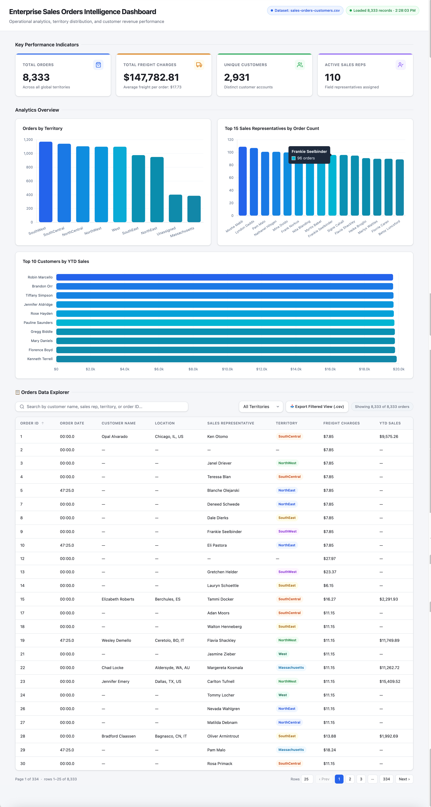

***

## Learning objectives

After completing this lab, you should be able to:

- Build an end-to-end data pipeline and dashboard application using natural-language prompts in IBM Bob.
- Apply an AI-assisted development workflow to join relational tabular datasets using foreign key hash maps.
- Implement data sanitization practices by identifying and removing sensitive PII before publishing merged deliverables.
- Use PapaParse to parse client-side CSV data in the browser without requiring a backend database server.
- Construct interactive, responsive data visualizations using Chart.js to analyze order volume, sales rep rankings, and customer revenue.
- Build real-time client-side search and filtering features across multi-column data tables.

***

## About this lab

In this lab, you act as an Enterprise Data and Operations Analyst responsible for connecting fragmented sales transaction data across your organization. Your business stakeholders have provided three separate CSV exports: `ORDERS.csv` (transaction records), `CUSTOMERS.csv` (customer accounts and revenue), and `SALES.csv` (sales team directory and territory assignments).

Your mission is to build a reliable data merge pipeline and an operational web dashboard that includes the following features:

- A Node.js data merge script that joins order, customer, and sales representative records on common keys (`CUST_ID` and `SALESREP_ID`) while filtering out sensitive PII fields.
- Executive KPI summary cards displaying Total Orders, Total Freight Charges (formatted in USD), Unique Customers, and Active Sales Representatives.
- An interactive Chart.js bar chart displaying order volume across sales territories.
- An interactive Chart.js bar chart ranking the top 15 sales representatives by order count.
- An interactive Chart.js horizontal bar chart highlighting the top 10 customers by year-to-date (YTD) sales.
- A client-side searchable orders data table with live keyword filtering across customer names, sales rep names, and territories.

Throughout the lab, you'll guide IBM Bob with clear instructions and specific requirements. IBM Bob handles the technical details and coding. You'll focus on what you want the application to do, and IBM Bob will create it for you.

**Note:** Bob dynamically responds to prompts; therefore, your application may look slightly different from the screen images shown in this lab. Prompt Bob to make additional changes based on your preferences for the features and user interface.

***

## About the dataset

This lab uses enterprise sales transaction and customer management data structured into three relational CSV files, which are merged into a single consolidated output file.

- **Enterprise Sales Transaction Data** records business-to-business sales orders across an organization. Each transaction captures key details such as order identifiers, dates and times, freight or shipping charges, and the sales representative responsible for the sale. The dataset supports revenue tracking, order fulfillment monitoring, and sales performance analysis across territories and teams.

- **Customer Management Data** holds master records for an organization's customer base. Each record includes contact and address information, year-to-date sales figures, assigned sales representative, nationality, and payment details. This dataset serves as the primary source of customer identity and relationship data, and is the principal table for sensitive personally identifiable information (PII) in the system.

- `ORDERS.csv`: Raw transaction records (8,333 rows)
  - Columns include:
    - `ORDER_ID`: Unique order identifier
    - `CUST_ID`: Foreign key linking to customer record
    - `ORDER_DATE`: Date order was placed
    - `ORDER_TIME`: Time order was placed
    - `FREIGHT_CHARGES`: Freight/shipping charge amount (USD)
    - `SALESREP_ID`: Sales representative assigned to order
    - `ORDER_POSTED_DATE`: Transaction posting date

The following image shows the first 10 rows of the orders dataset:

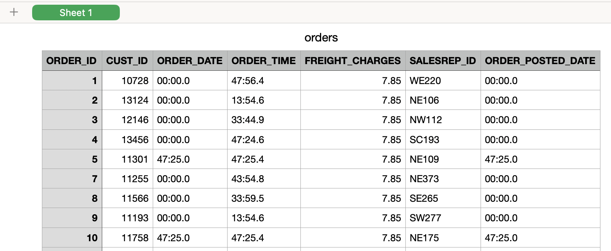


- `CUSTOMERS.csv`: Customer directory (902 rows)
  - Columns include:
    - `CUST_ID`: Unique customer identifier
    - `CUSTNAME`: Company or customer name
    - `CITY`: Customer city
    - `STATE`: Customer state/province
    - `COUNTRY_CODE`: Country code
    - `CUST_EMAIL`: Customer email address
    - `YTD_SALES`: Year-to-date sales total (USD)
    - `SALESREP_ID`: Primary assigned sales representative
    - *Sensitive PII fields (credit cards, national IDs, driver licenses) are stripped during the merge.*

The following image shows the first 10 rows of the customers dataset:

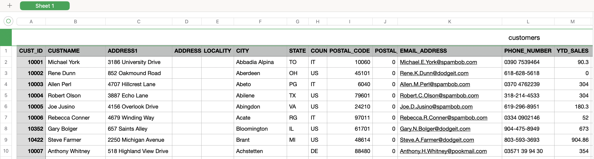

- `SALES.csv`: Sales organization directory (104 rows)
  - Columns include:
    - `SALESREP_ID`: Unique sales representative identifier
    - `FIRST_NAME`: Sales representative first name
    - `LAST_NAME`: Sales representative last name
    - `TERRITORY`: Assigned geographic sales territory
    - `EMAIL_ADDRESS`: Sales representative corporate email
    - `MANAGER_ID`: Manager identifier

The following image shows the first 10 rows of the sales dataset:

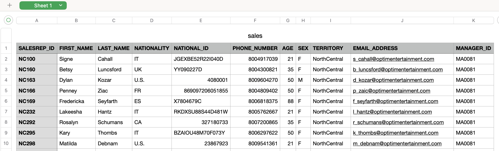

- `sales-orders-customers.csv`: Merged relational output (8,333 rows)
  - Combined schema containing 18 sanitized fields linking orders, customers, and sales representative metadata.


***

## Estimated time

**60–90 minutes**

***

## Prerequisites

**Tip:** Right-click the following link, and open the page in a new tab.

Complete the prerequisite tasks of [Get started with IBM Bob](../../ai-in-sports/get-started-with-ibm-bob.md)

***

<a name="top"></a>

## Contents

- [Task 1: Set up the project](#task01)
- [Task 2: Build the data merge script](#task02)
- [Task 3: Create the starter dashboard layout](#task03)
- [Task 4: Add executive KPI summary cards](#task04)
- [Task 5: Build interactive Chart.js visualizations](#task05)
- [Task 6: Build the searchable orders data table](#task06)
- [Task 7: Enhance and polish the dashboard](#task07)
- [Summary](#summary)
- [Additional resources](#additional-resources)

***

<!--

# Preview the tutorial

Watch the following video to see a preview of the steps in this tutorial.

**Note:** Some user interface elements in the video might look different from your IBM Bob environment.

**Tip:** Right-click the following thumbnail image, and open the video in a new tab.

<a href="https://video.ibm.com/embed/channel/23669513/video/ai-in-data-sales-orders">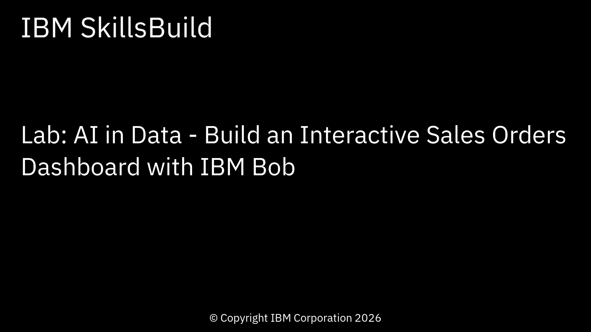</a>

***

-->

<a name="task01"></a>

## Task 1: Set up the project

In this task, you will complete the following tasks to set up the project:

- Create a project folder and verify the source data files are placed in the `data/` directory.
- Configure a Node.js project environment supporting ES Modules (`"type": "module"`).
- Install the required open-source data parsing and stringifying libraries (`csv-parse` and `csv-stringify`).

Don't worry if you don't have these packages installed yet — IBM Bob will help you check and install them!

## Task 1a: Set up the project folder and data

Follow these steps to create the lab folder and place the datasets:

1. Choose a folder location for the lab work.
1. Download the [sales-orders-data.zip](sales-orders-data.zip) file to your lab folder. The zip file contains `ORDERS.csv`, `CUSTOMERS.csv`, and `SALES.csv`. **Tip:** Right-click the link, and open the page in a new tab.
1. In Bob, open the terminal window: click **Terminal > New Terminal**.
1. Use the `cd` command in the terminal panel to move into that folder.
1. Create a folder for your project and extract the provided data files into it:

   ```
   mkdir ai-in-data-sales-orders
   unzip sales-orders-data.zip -d ai-in-data-sales-orders/data
   cd ai-in-data-sales-orders
   ```

1. Open the ai-in-data-sales-orders folder:

   1. Click **File > Open Folder**.
   1. Navigate to the **ai-in-data-sales-orders** folder.
   1. Click **Open**.

*Results:* The project folder, *ai-in-data-sales-orders*, contains `data/ORDERS.csv`, `data/CUSTOMERS.csv`, and `data/SALES.csv`.

## Task 1b: Set up the environment

Follow these steps to initialize the Node.js project and install the dependencies:

1. In the Bob chat side panel, select **Agent** mode.

   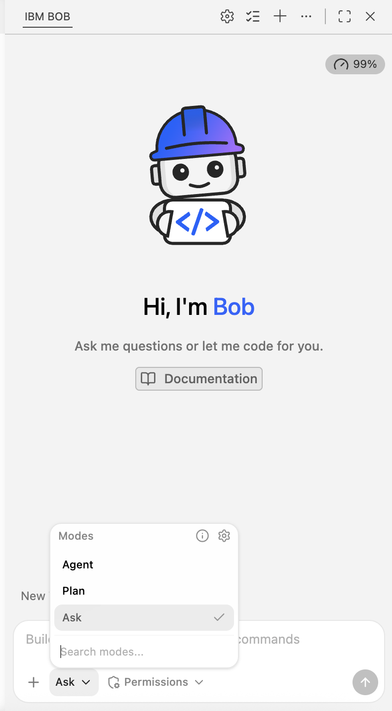

1. In the Bob chat panel, copy and paste the following prompt to ask Bob to set up and verify the prerequisite environment.

   ### What this prompt does
   Before you build the solution, you need a project workspace with the correct tools and folder structure. With this prompt, IBM Bob creates the project configuration, installs the required libraries, and verifies that the source data files are available.
   
   ### How it works
   Node.js provides the runtime environment that will execute the data-processing scripts. Bob uses the setup instructions in the prompt to create the project files, install dependencies, and prepare the folders that will hold our data pipeline and dashboard components.

   ```text
   I need to set up a Node.js data processing and dashboard project in this folder.

   Please complete the following setup steps:
   1. Initialize a package.json file configured for ES Modules ("type": "module") with name "sales-orders-lab".
   2. Install csv-parse and csv-stringify as project dependencies.
   3. Add an npm script called "merge": "node scripts/merge.js".
   4. Create the directory structure:
      - scripts/
      - dashboard/
      - data/ (verify data/ORDERS.csv, data/CUSTOMERS.csv, and data/SALES.csv exist)
   5. Verify Node.js and npm versions and confirm when everything is ready.
   ```

1. To confirm permission to complete the tasks, click **Approve once** when prompted by Bob, and follow the prompts.

### What Bob does

Bob completes the following tasks based on the prompt:

- Creates a `package.json` file configured with `"type": "module"` and a `"merge"` run script
- Installs `csv-parse` and `csv-stringify` into `node_modules`
- Creates the `scripts/` and `dashboard/` directories alongside the existing `data/` directory
- Verifies that all three source CSV files exist under `data/`

The following image shows the verified project setup:

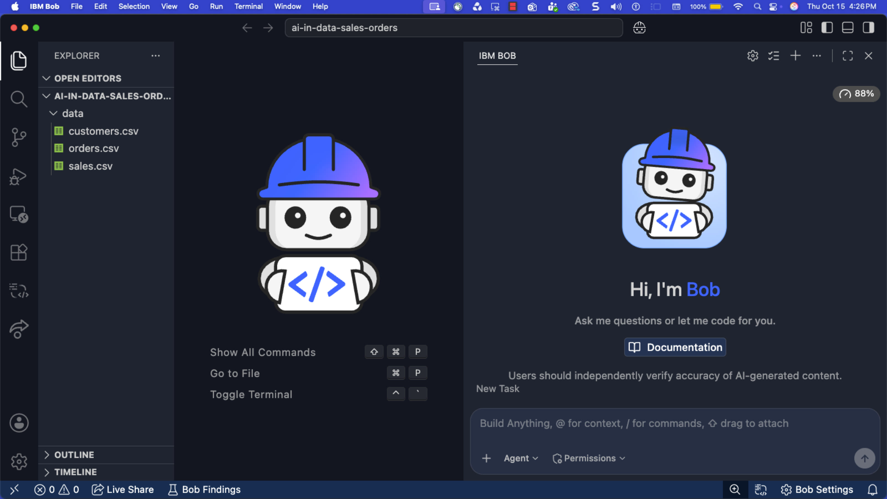

[Back to the top](#top)

***

<a name="task02"></a>

## Task 2: Build the data merge script

In this task, you will prompt Bob to create a Node.js script (`scripts/merge.js`) that loads and parses all three CSV files, and then joins each order with its corresponding customer and sales rep. Lastly, the script sanitizes the data by removing sensitive customer PII (personally identifiable information), and outputs the consolidated dataset to `data/sales-orders-customers.csv`.

Follow these steps to build and execute the merge script:

1. Copy and paste the following prompt into Bob's chat panel.

   ### What this prompt does
   The source data is spread across multiple CSV files, with each file containing only part of the business picture. With this prompt, IBM Bob builds a data pipeline that combines these separate files into a single dataset to be analyzed and visualized in the dashboard.

   ### How it works
   Node.js reads each CSV file, matches related records using shared identifiers such as Customer ID and Sales Representative ID, removes sensitive information that should not appear in reports, and writes the cleaned results into a consolidated output file.

   ```text
   Create a Node.js data merge script at scripts/merge.js that joins ORDERS.csv, CUSTOMERS.csv, and SALES.csv into a unified, sanitized CSV file at data/sales-orders-customers.csv.

   Requirements for scripts/merge.js:
   1. Use ES module imports with csv-parse/sync (parse) and csv-stringify/sync (stringify), and node:fs / node:path.
   2. Read and parse data/ORDERS.csv, data/CUSTOMERS.csv, and data/SALES.csv using parse(content, { columns: true, skip_empty_lines: true, trim: true }).
   3. Build fast lookup Maps:
      - customerMap: keyed by CUST_ID
      - salesMap: keyed by SALESREP_ID
   4. Iterate through every order in ORDERS.csv and perform the relational joins:
      - Lookup customer using order.CUST_ID
      - Lookup sales rep using customer.SALESREP_ID (fallback to order.SALESREP_ID if missing)
   5. Sanitize customer data: Exclude all sensitive PII fields (credit cards, national IDs, driver licenses) and emit exactly these 18 output columns:
      - ORDER_ID
      - CUST_ID
      - ORDER_DATE
      - ORDER_TIME
      - FREIGHT_CHARGES
      - ORDER_POSTED_DATE
      - CUSTNAME
      - CITY
      - STATE
      - COUNTRY_CODE
      - CUST_EMAIL
      - YTD_SALES
      - SALESREP_ID
      - REP_FIRST_NAME
      - REP_LAST_NAME
      - TERRITORY
      - REP_EMAIL
      - MANAGER_ID
   6. Write the merged records to data/sales-orders-customers.csv.
   7. Log clear progress to console: row counts loaded from each source file, total merged rows written, and sample output columns.

   After creating scripts/merge.js, execute the script with `npm run merge` and report the results.
   ```

1. To confirm permission to complete the tasks, click **Approve once** when prompted by Bob, and follow the prompts.

## What Bob does

Bob completes the following tasks based on the prompt:

- Creates `scripts/merge.js` using synchronous CSV parsing and stringifying
- Constructs in-memory `Map` lookups for fast relational matching by `CUST_ID` and `SALESREP_ID`
- Joins order records with customer data and sales representative details
- Strips sensitive PII fields from the customer dataset
- Writes the 18-column merged dataset to `data/sales-orders-customers.csv`
- Runs `npm run merge` and confirms that all 8,333 orders were successfully merged

## Verify the merged data

1. Verify the script execution output in the Bob console. You should see a confirmation message indicating:
   - 8,333 orders loaded
   - 902 customers loaded
   - 104 sales reps loaded
   - 8,333 merged rows written to `data/sales-orders-customers.csv`
1. Open `data/sales-orders-customers.csv` to inspect the generated file and verify that the 18 columns match the expected schema without any raw credit card or ID numbers.

The following animated images shows the combined `sales-orders-customers.csv` file.

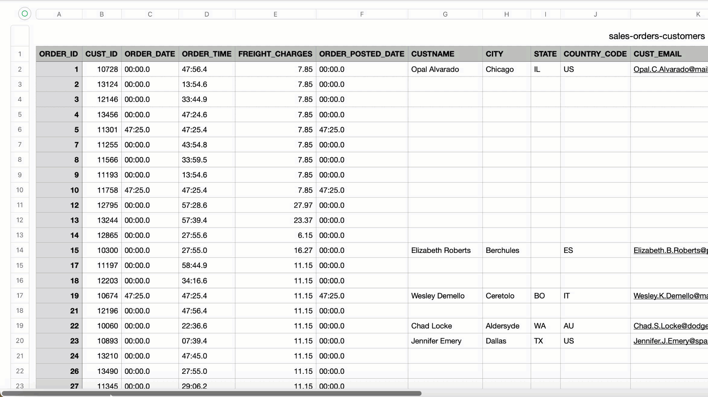

The following image shows the data merge script execution:

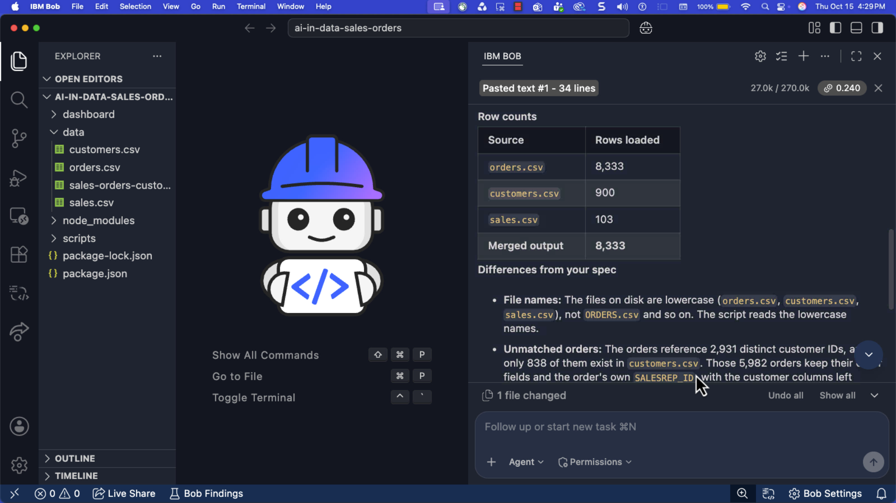

[Back to the top](#top)

***

<a name="task03"></a>

## Task 3: Create the starter dashboard layout

In this task, you will prompt Bob to create a clean, responsive single-page web dashboard at `dashboard/index.html`. The dashboard loads the newly generated `data/sales-orders-customers.csv` file directly in the browser, renders an executive header with dataset metadata including placeholders for the KPI Sumary Cards, Charts Grid, and Searchable Data Table sections.

Follow these steps to build the starter dashboard layout:

1. Copy and paste the following prompt into Bob's chat panel.

   ### What this prompt does
   Now that the data has been unified, you create the dashboard that business users will interact with. With this prompt, IBM Bob generates the application's main web page and prepares it to display sales information.

   ### How it works
   The dashboard uses HTML to structure the page, CSS to control the visual layout, and JavaScript to load the merged CSV file directly in the browser. The application then uses that data to drive the metrics, charts, and tables added in later steps.

   ```text
   Create a responsive, modern HTML5 sales orders dashboard in dashboard/index.html that loads and parses data/sales-orders-customers.csv in the browser.

   Requirements for dashboard/index.html:
   1. Self-contained single file with embedded clean modern CSS (custom properties, clean card styling, responsive grid layout, neutral color palette with corporate blue accents).
   2. Include CDN script tags in <head> for:
      - PapaParse (https://cdn.jsdelivr.net/npm/papaparse@5.4.1/papaparse.min.js)
      - Chart.js (https://cdn.jsdelivr.net/npm/chart.js@4.4.1/dist/chart.umd.min.js)
   3. Page Header:
      - Title: "Enterprise Sales Orders Intelligence Dashboard"
      - Subtitle: "Operational analytics, territory distribution, and customer revenue performance"
      - Status pill badge: "Dataset: sales-orders-customers.csv" and dynamic load timestamp.
   4. JavaScript data loader:
      - On DOMContentLoaded, fetch and parse "../data/sales-orders-customers.csv" using Papa.parse with header: true, dynamicTyping: true, and skipEmptyLines: true.
      - Handle loading and error states gracefully with a visual spinner or status message.
      - Store parsed data in a global variable `salesData` and log the loaded record count to the browser console.
   5. Create placeholder container sections for the following sections; but only include a header for the section, leave the rest of the section blank with no data:
      - KPI Summary Cards (#kpi-section)
      - Charts Grid (#charts-section)
      - Searchable Data Table (#table-section)

   Tell me how to preview dashboard/index.html in my web browser.
   ```

1. To confirm permission to complete the tasks, click **Approve once** when prompted by Bob, and follow the prompts.

## What Bob does

Bob completes the following tasks based on the prompt:

- Creates `dashboard/index.html` with a modern, responsive layout and embedded CSS
- Loads PapaParse and Chart.js libraries via CDN
- Renders an executive header with the dashboard title, subtitle, and status badge
- Implements an asynchronous CSV loader that fetches and parses `data/sales-orders-customers.csv` on page load
- Prepares structured container sections for KPI cards, visualizations, and the data table

## Explore the application

1. Open `dashboard/index.html` in your web browser, or serve the directory using a lightweight local web server:

   ```bash
   npx serve .
   ```

1. Open your browser and navigate to the local URL (for example, `http://localhost:3000/dashboard/index.html`).
1. Open your browser Developer Tools (press **F12** or right-click and select **Inspect > Console**).
1. Verify that the console displays a confirmation log showing **8,333 records successfully parsed**.

The following image shows the starter dashboard layout. Notice that Bob created placeholder containers sections for the KPI Summary Cards, Charts Grid, and Searchable Data Table sections. These section will updated in the upcoming tasks.

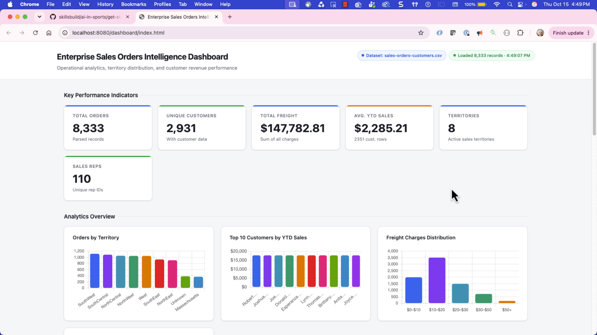

[Back to the top](#top)

***

<a name="task04"></a>

## Task 4: Add executive KPI summary cards

In this task, you will prompt Bob to compute key operational metrics from the loaded dataset and render them as four responsive executive KPI summary cards at the top of the dashboard.

Follow these steps to add the executive KPI summary cards:

1. Copy and paste the following prompt into Bob's chat panel.

   ### What this prompt does
   Executives often want a quick summary of business performance before exploring detailed data. With this prompt, IBM Bob creates KPI cards that highlight the most important operational metrics.

   ### How it works
   The dashboard calculates values directly from the loaded dataset and displays them in summary cards. These metrics provide an at-a-glance view of order volume, freight charges, customer activity, and sales representative participation.

   ```text
   Add an Executive KPI Summary Cards component to dashboard/index.html inside the #kpi-section.

   Requirements:
   1. Write a function renderKPICards(data) that calculates the following metrics across all rows:
      - Total Orders: Total count of order records (formatted with commas, e.g. 8,333)
      - Total Freight Charges: Sum of FREIGHT_CHARGES formatted as USD currency (e.g. $512,340 or formatted to 2 decimal places)
      - Unique Customers: Distinct count of CUST_ID values
      - Active Sales Reps: Distinct count of non-empty SALESREP_ID values
   2. Render 4 responsive metric cards in a CSS grid layout:
      - Each card should include an icon/badge, metric title, bold formatted value, and a descriptive subtitle (e.g. "Across all global territories", "Average freight per order: $XX.XX").
   3. Call renderKPICards(salesData) immediately after PapaParse finishes parsing the CSV.

   Keep all existing styling and layout intact.
   ```

1. To confirm permission to complete the tasks, click **Approve once** when prompted by Bob, and follow the prompts.

## What Bob does

Bob makes the following modifications to the application based on the prompt:

- Implements `renderKPICards(data)` to compute total orders, total freight revenue/charges, distinct customer count, and distinct sales rep count
- Renders four styled KPI cards with metric titles, values formatted as integers and currency, and contextual subtext
- Hooks the KPI calculation into the PapaParse completion callback

## Explore the application

1. Refresh your browser window.
1. Explore the application. Notice the following elements:
   - Four KPI cards appear below the header.
   - **Total Orders** displays **8,333**.
   - **Unique Customers** displays **2931**.
   - **Active Sales Reps** displays **110**.
   - **Total Freight Charges** displays the sum of all shipping charges formatted as currency.

The following image shows the executive KPI cards implemented:

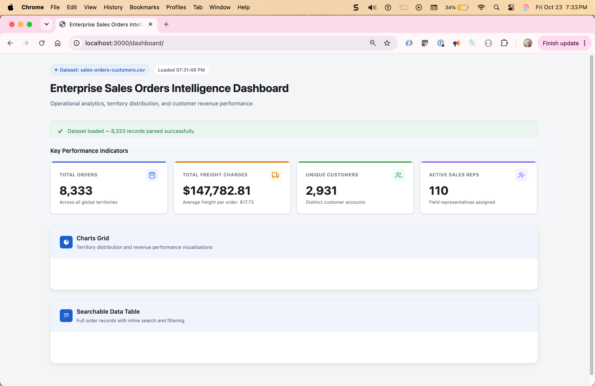

[Back to the top](#top)

***

<a name="task05"></a>

## Task 5: Build interactive Chart.js visualizations

In this task, you will prompt Bob to add three interactive Chart.js visual analytics components to the `#charts-section` grid. The charts provide operational insights into geographic order distribution, top-performing sales representatives, and top revenue-generating customers.

Follow these steps to add the interactive visualizations:

1. Copy and paste the following prompt into Bob's chat panel.

   ### What this prompt does
   Tables and KPI cards summarize information, but charts make trends and patterns easier to see. With this prompt, IBM Bob adds visual analytics that highlight territory performance, sales representative activity, and customer revenue.

   ### How it works
   Chart.js converts aggregated sales data into interactive visualizations. The dashboard groups and summarizes data behind the scenes, then presents the results as charts that can be explored visually.

   ```text
   Add interactive Chart.js visualizations to dashboard/index.html inside the #charts-section.

   Requirements:
   1. Create a responsive 2-column charts grid layout containing 3 chart cards:
      - Chart 1: "Orders by Territory" (Vertical Bar Chart)
        * Aggregate order counts by TERRITORY (handle empty/unassigned as "Unassigned")
        * Sort territories descending by order volume
        * Display territory names on X-axis, order count on Y-axis
      - Chart 2: "Top 15 Sales Representatives by Order Count" (Vertical Bar Chart)
        * Aggregate order count by sales rep full name (`${REP_FIRST_NAME} ${REP_LAST_NAME}` or SALESREP_ID)
        * Sort descending and take the top 15 reps
        * Display sales rep names on X-axis and order counts on Y-axis
      - Chart 3: "Top 10 Customers by YTD Sales" (Horizontal Bar Chart)
        * Aggregate or extract top 10 unique customers by YTD_SALES value
        * Sort descending order, highest YTD_SALES to lowest YTD_SALES
        * Display customer names on Y-axis and sales amount formatted in USD on X-axis
   2. Chart Styling & Features:
      - Use a cohesive color palette (corporate blues, teals, and slate accents).
      - Enable responsive resizing (maintainAspectRatio: false inside fixed-height chart containers ~320px).
      - Configure clean tooltips with formatted numbers and currency values.
   3. Write a function renderCharts(data) that aggregates the data, instantiates the Chart instances, and is invoked after PapaParse loads.

   Keep all existing KPI cards and layout intact.
   ```

1. To confirm permission to complete the tasks, click **Approve once** when prompted by Bob, and follow the prompts.

## What Bob does

Bob makes the following modifications to the application based on the prompt:

- Aggregates the parsed sales records by territory, sales representative name, and customer YTD sales
- Instantiates three Chart.js visualizers:
  - Vertical bar chart for **Orders by Territory**
  - Vertical bar chart for **Top 15 Sales Representatives**
  - Horizontal bar chart for **Top 10 Customers by YTD Sales**
- Adds formatted tooltips, responsive canvas wrappers, and custom color palettes

## Explore the application

1. Refresh your browser window.
1. Complete the following steps to explore the charts:
   1. Hover over the bars in the **Orders by Territory** chart to see exact order volume per territory.
   2. Inspect the **Top 15 Sales Representatives** chart to see the highest-volume reps across the organization.
   3. Hover over the horizontal bars in the **Top 10 Customers** chart to inspect top enterprise account revenue formatted in USD.

The following image shows the interactive Chart.js visualizations implemented:

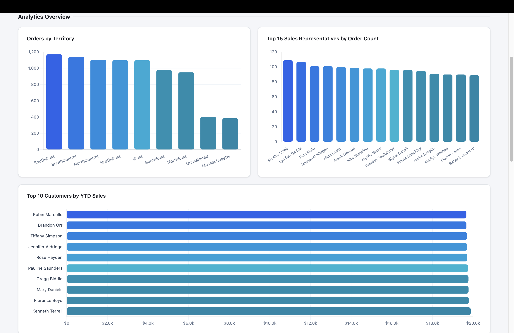

[Back to the top](#top)

***

<a name="task06"></a>

## Task 6: Build the searchable orders data table

In this task, you will prompt Bob to add an interactive, client-side searchable data table to the `#table-section`. The table displays detailed order rows and features an instant search filter that dynamically evaluates customer names, sales rep names, and territory values in real time.

Follow these steps to add the searchable data table:

1. Copy and paste the following prompt into Bob's chat panel.

   ### What this prompt does
   While charts provide summaries, users often need to locate specific records and investigate individual transactions. With this prompt, IBM Bob creates a searchable data explorer for the detailed order data.

   ### How it works
   The dashboard keeps the merged dataset in browser memory and dynamically filters rows as users type. This creates a fast, interactive experience without requiring a separate database or backend service.

   ```text
   Add an interactive searchable data table to dashboard/index.html inside the #table-section.

   Requirements:
   1. Table Controls Header:
      - Section Title: "📋 Orders Data Explorer"
      - Search Input: Text input with placeholder "Search by customer name, sales rep, territory, or order ID..."
      - Record Counter Badge: Live display showing "Showing X of Y orders" based on active search filter.
   2. Table Structure & Columns:
      - Render a clean HTML table displaying:
        * Order ID
        * Order Date
        * Customer Name
        * Location (City, State, Country)
        * Sales Representative
        * Territory
        * Freight Charges ($USD formatted)
        * YTD Sales ($USD formatted)
   3. Real-Time Search Filter:
      - Add an input event listener on the search input.
      - Filter rows client-side matching query (case-insensitive) across CUSTNAME, REP_FIRST_NAME, REP_LAST_NAME, TERRITORY, ORDER_ID, and CITY.
      - Dynamically re-render table body and update the live record counter badge as the user types.
      - If no matching records are found, show a friendly "No matching orders found" empty state.
   4. Limit initial rendered view or implement smooth scrolling/virtualization so the browser renders smoothly.

   Keep all existing header, KPI cards, and charts intact.
   ```

1. To confirm permission to complete the tasks, click **Approve once** when prompted by Bob, and follow the prompts.

## What Bob does

Bob makes the following modifications to the application based on the prompt:

- Adds the "Orders Data Explorer" section with a search bar and a dynamic "Showing X of Y orders" counter badge
- Renders an order records table showing order IDs, dates, customer names, geographic locations, assigned sales reps, territories, freight fees, and YTD sales
- Implements real-time multi-column search filtering with instant DOM updates and empty-state messaging

## Explore the application

1. Refresh your browser window.
1. Scroll to see the table after the KPI cards and charts.
1. Complete the following steps to explore the data table:
   1. Type a territory name (for example, `North` or `East`) into the search box. Notice the table instantly filters to matching rows and the counter badge updates.
   2. Type a specific customer or company name to view all transaction records associated with that customer.
   3. Clear the search box to verify that the table resets to show all records.

The following image shows the searchable data table implemented:

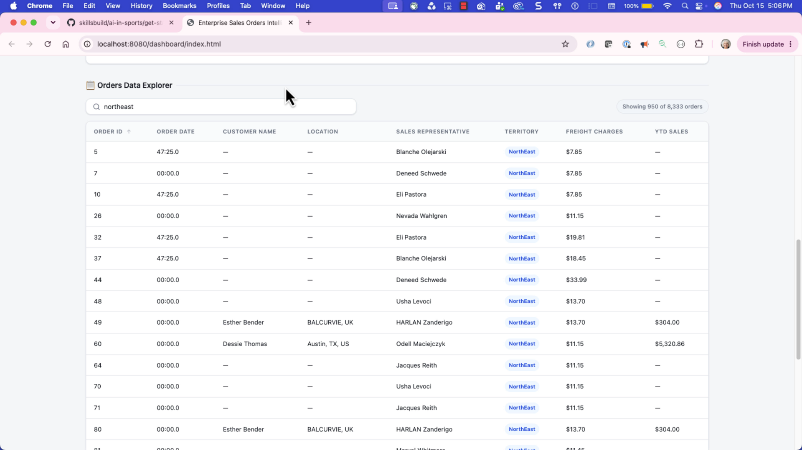

[Back to the top](#top)

***

<a name="task07"></a>

## Task 7: Enhance and polish the dashboard

In this task, you will prompt Bob to add operational enhancements to the dashboard, including a territory filter dropdown, pagination controls for the data table, and a CSV export feature.

Follow these steps to enhance and polish the dashboard:

1. Copy and paste the following prompt into Bob's chat panel.

   ### What this prompt does
   The core dashboard is now complete. With this prompt, IBM Bob adds usability features that make the application more practical for day-to-day business analysis.

   ### How it works
   Additional controls such as filters, pagination, and export capabilities allow users to focus on specific subsets of data, navigate large result sets more efficiently, and share filtered results with others.

   ```text
   Add operational enhancements and UI polish to dashboard/index.html.

   Enhancement requirements:
   1. Territory Quick-Filter Dropdown:
      - Add a <select> dropdown alongside the search bar populated dynamically with all unique territories (plus an "All Territories" option).
      - Selecting a territory filters both the data table and updates the KPI summary cards dynamically.
   2. Table Pagination:
      - Add clean pagination controls below the table (Page X of Y, Previous / Next buttons, and Page Size selector: 15, 25, 50, 100 rows).
   3. CSV Export Button:
      - Add an "📥 Export Filtered View (.csv)" button that downloads the currently filtered rows as a CSV file.
   4. Visual Polish:
      - Enhance hover states on table rows.
      - Ensure smooth mobile responsiveness across all cards, charts, and table controls.

   Change nothing else in the underlying data loader.
   ```

1. To confirm permission to complete the tasks, click **Approve once** when prompted by Bob, and follow the prompts.

## What Bob does

Bob makes the following modifications to the application based on the prompt:

- Adds a territory dropdown filter that coordinates with the search bar and recalculates KPI metrics
- Implements table pagination with page size controls (15, 25, 50, 100 rows) and navigation buttons
- Adds an export button that generates and downloads a CSV of the active filtered dataset
- Polishes row hover effects and responsive spacing across mobile and desktop viewports

## Explore the application

1. Refresh your browser window.
1. Scroll to see the table after the KPI cards and charts.
1. Complete the following steps to explore the enhanced dashboard:
   1. Select a territory from the **Territory Filter** dropdown. Notice that the KPI cards, chart highlights, and table update dynamically to reflect that territory.
   2. Use the pagination buttons (**Previous** / **Next**) and change the page size dropdown to browse through order records.
   3. Click **Export Filtered View (.csv)** to verify that a sanitized CSV of your active search and territory filter downloads directly to your computer.

The following image shows the enhancements to the dashboard. In particular, notice the **Export Filtered View** button.

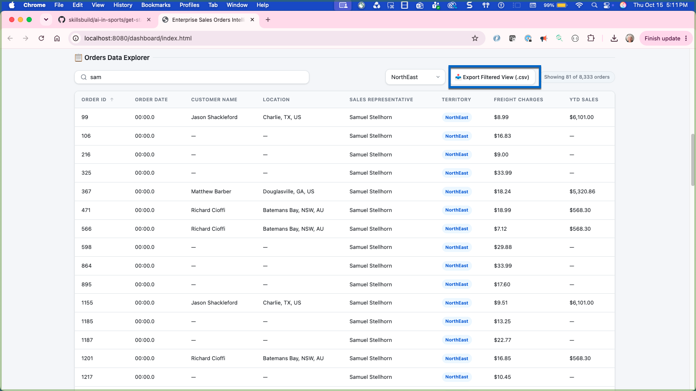

The following image shows the completed sales orders intelligence dashboard:


[Back to the top](#top)

***

<a name="summary"></a>

## Summary

In this lab, you built an end-to-end sales intelligence data pipeline and operational dashboard. You used Node.js to merge multi-table relational CSV exports (`ORDERS.csv`, `CUSTOMERS.csv`, and `SALES.csv`), sanitized customer data by removing sensitive PII, loaded the dataset client-side with PapaParse, displayed executive KPI summary metrics, visualized territory and sales performance with Chart.js, and delivered an interactive searchable and filterable orders portal.

### What you learned

Now that you have completed this lab, you should be able to:

- Build an enterprise data pipeline and web dashboard using natural-language prompts in IBM Bob.
- Follow an AI-assisted development workflow by generating, reviewing, and refining data transformations and frontend features.
- Merge multi-table relational CSV exports in Node.js using hash map lookups.
- Implement data privacy controls by stripping sensitive customer PII from merged deliverables.
- Parse tabular CSV data in the browser using PapaParse without backend server overhead.
- Build interactive data visualizers using Chart.js to reveal territory trends, top sales reps, and customer revenue.
- Implement real-time multi-column search, territory filtering, pagination, and CSV data export in a responsive web interface.

[Back to the top](#top)

<a name="additional-resources"></a>

## Additional resources

- [IBM Bob documentation](https://bob.ibm.com/docs)
- [Node.js Documentation](https://nodejs.org/docs/)
- [csv-parse Documentation](https://csv.js.org/parse/)
- [csv-stringify Documentation](https://csv.js.org/stringify/)
- [PapaParse Documentation](https://www.papaparse.com/)
- [Chart.js Documentation](https://www.chartjs.org/)
