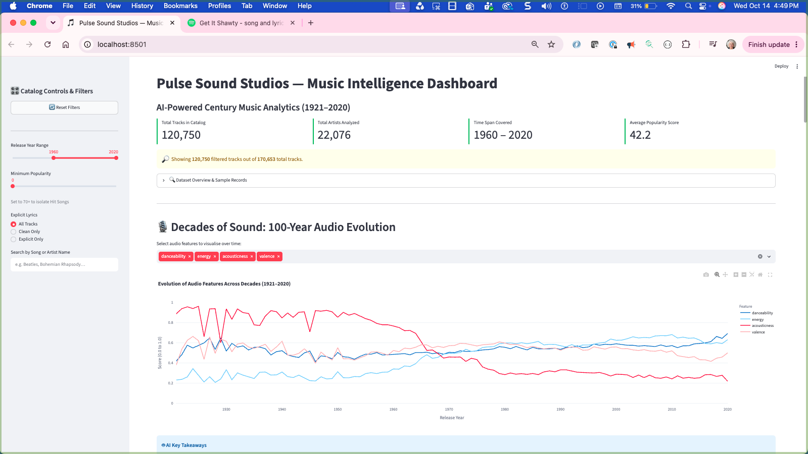
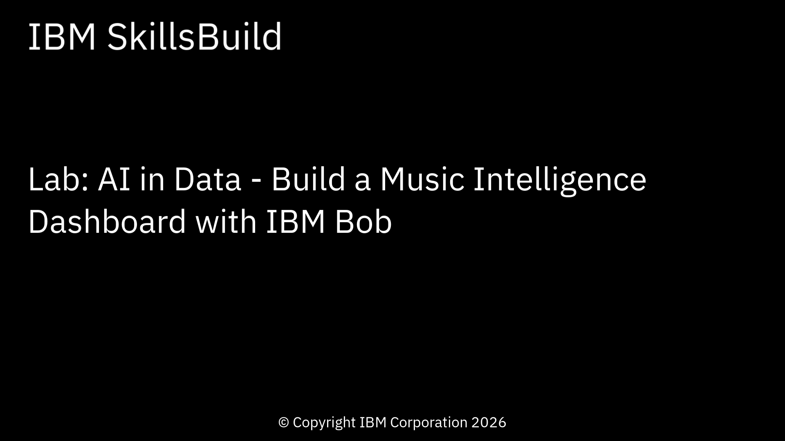
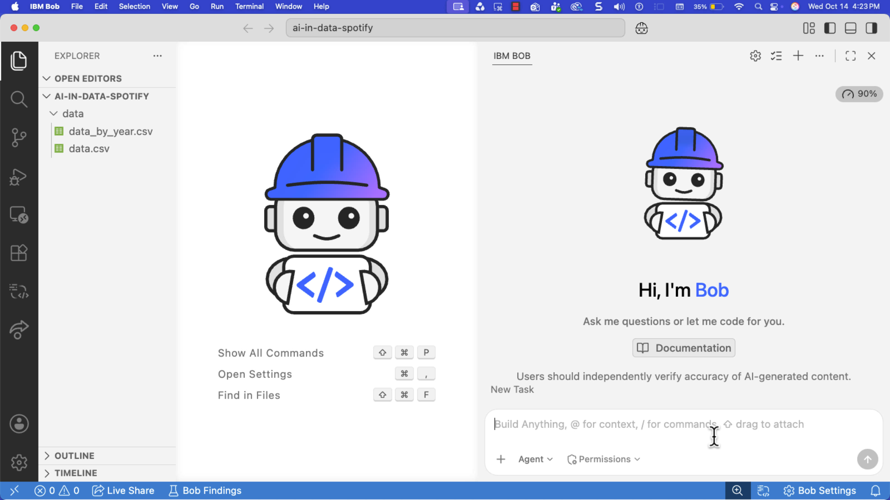
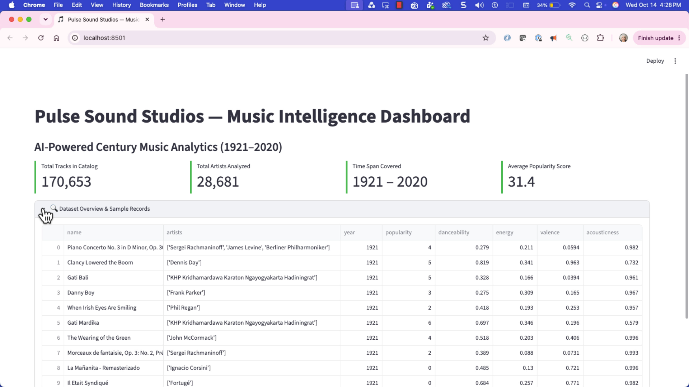
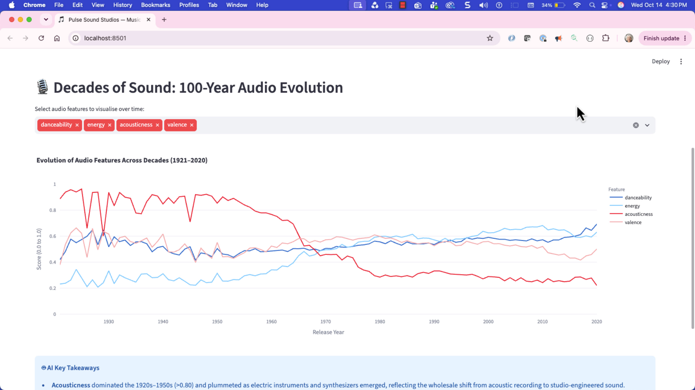
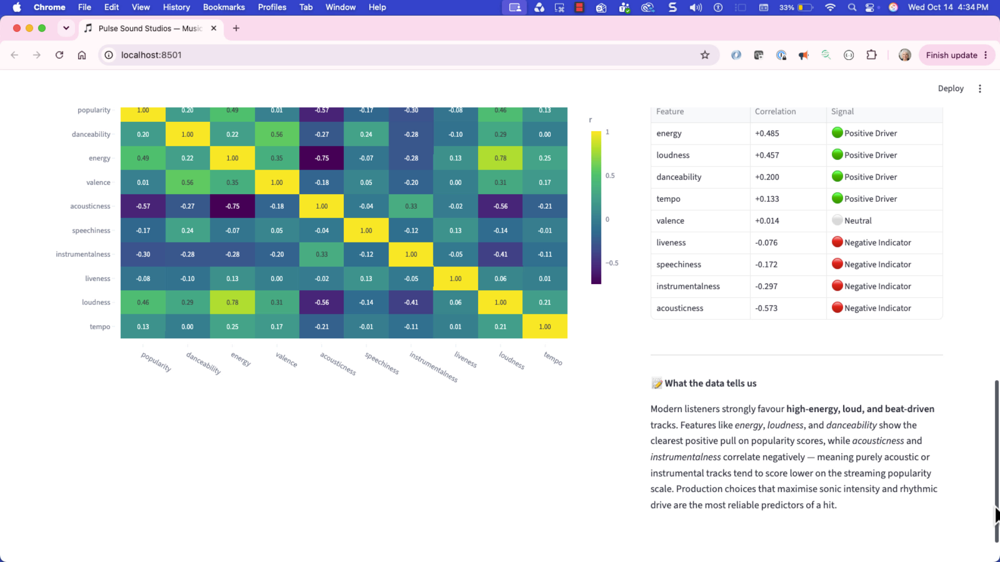
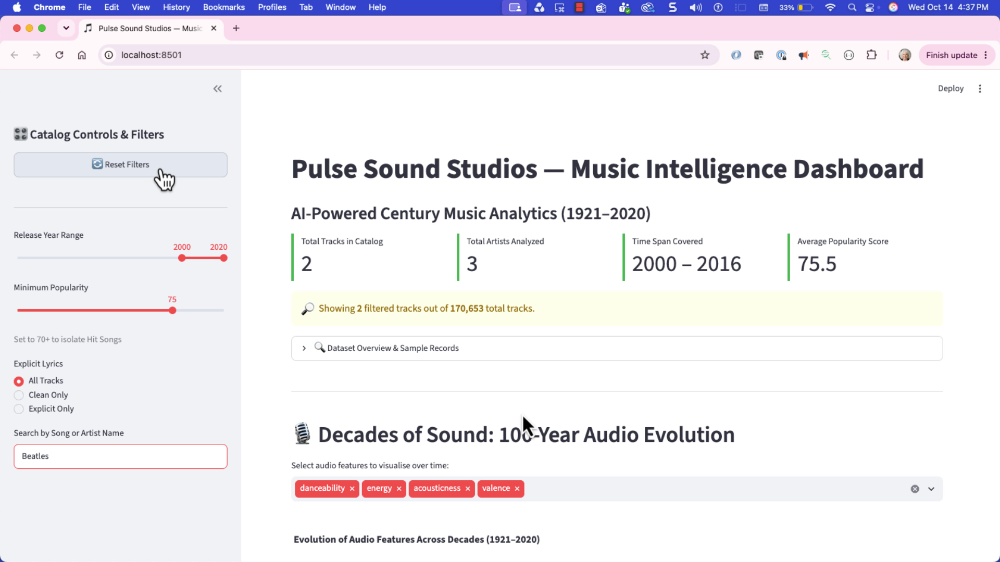
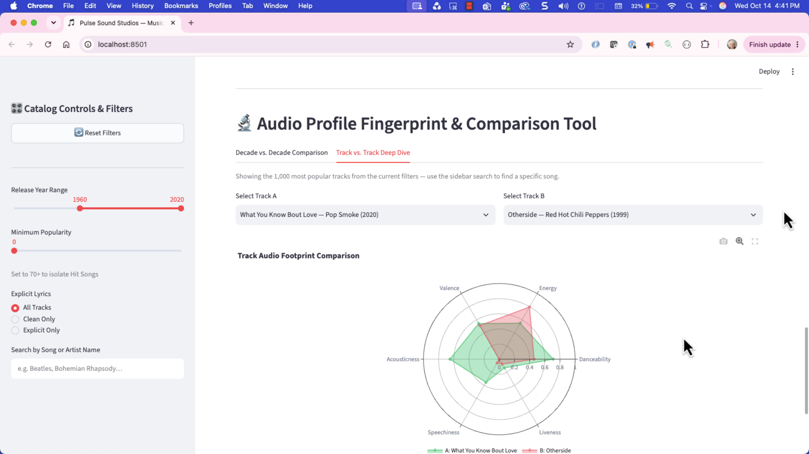
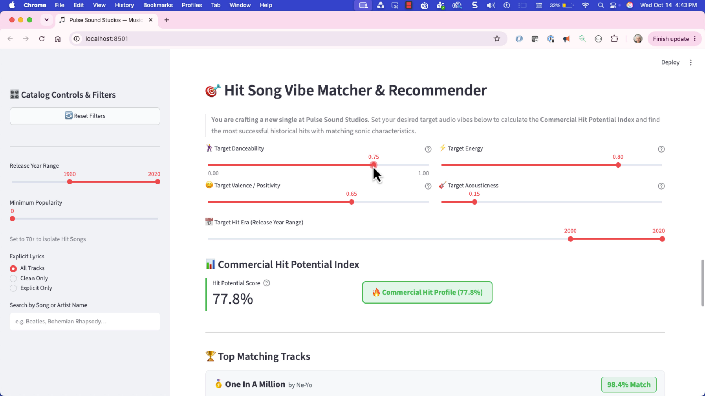
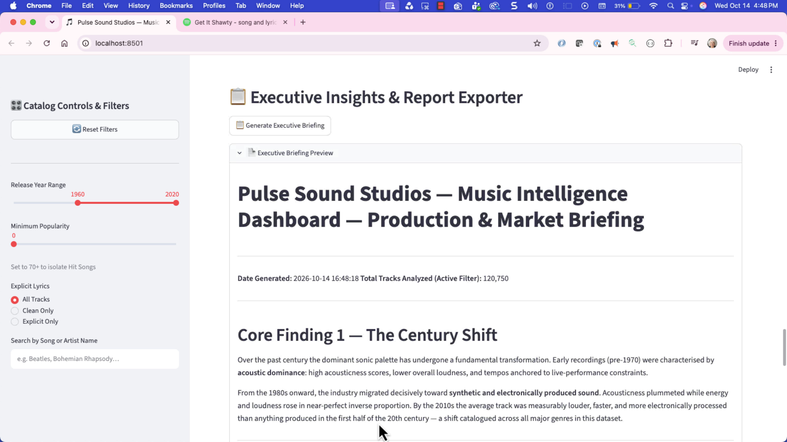

## Overview

Turn a century of streaming data into decisions your label can act on — without writing a single line of code. Learn how to use Generative AI with Python and Streamlit to build a music intelligence dashboard that profiles 170,000+ Spotify tracks, analyzes how sound has evolved across 100 years, decodes the audio characteristics that drive hit songs, and recommends matching tracks for new productions. Along the way, you'll collaborate with IBM Bob to build a real-world data analytics application step by step, gaining hands-on experience with AI-assisted development, exploratory data analysis, correlation modeling, and interactive dashboard development.

In this lab, you build an application that scores tracks by audio feature, reveals century-long trends, routes your target vibe to the closest historical hits, and exports an executive briefing for the Head of A&R.



***

## Learning objectives

After completing this lab, you should be able to:

- Build a multi-feature data analytics application using natural-language prompts in IBM Bob.
- Apply an AI-assisted development workflow to iteratively build and improve application features.
- Analyze dataset characteristics and statistical summaries to uncover meaningful insights.
- Evaluate relationships and trends in music data to identify significant patterns over time.
- Construct interactive analytical tools that enable data filtering, comparison, and discovery.
- Synthesize insights into a business-focused executive briefing with actionable recommendations.

***

## About this lab

In this lab, you build an interactive music intelligence dashboard for **Pulse Sound Studios**, a fictional independent record label. The scenario: you are a Junior Music Data Analyst. The Head of A&R and executive leadership want to sign new talent and produce chart-topping music, and they've given you a dataset of 170,000+ Spotify tracks spanning 100 years (1921 to 2020) with audio characteristics including danceability, energy, acousticness, valence, tempo, and loudness.

The application includes the following features:

- A KPI metrics row showing total tracks, artists analyzed, time span covered, and average popularity
- A 100-year audio evolution chart showing how sound characteristics shifted decade by decade
- A hit DNA correlation matrix identifying which audio features drive streaming popularity
- Interactive sidebar controls for decade filtering, popularity thresholds, and keyword search
- An audio profile fingerprint tool with radar charts for comparing eras and individual tracks
- A hit potential index and vibe matcher with direct Spotify listening links
- A downloadable executive briefing for the Head of A&R

Throughout the lab, you'll guide IBM Bob with clear instructions and specific requirements. IBM Bob will help you build the application using modern data tools without any prerequisite knowledge of coding. IBM Bob handles the technical details. You'll focus on what you want the application to do, and IBM Bob will create it for you.

**Note:** Bob dynamically responds to prompts; therefore, your application may look different from the screen images shown in this lab. Prompt Bob to make additional changes based on your preferences for the features and user interface.

***

## About the dataset

This lab uses a dataset of Spotify tracks with audio characteristics covering 100 years of recorded music. The data is sourced from the Spotify API and made available through Kaggle.

**Tip:** Right-click the following links, and open the pages in a new tab.

- `data.csv`: [Spotify Tracks Dataset](https://www.kaggle.com/datasets/lehaknarnauli/spotify-datasets)
  - Columns include:
    - name
    - artists
    - year
    - popularity
    - danceability
    - energy
    - valence
    - acousticness
    - instrumentalness
    - liveness
    - loudness
    - speechiness
    - tempo
    - duration_ms
    - explicit
    - key
    - mode
    - id
    - release_date
- `data_by_year.csv`: [Spotify Tracks Dataset](https://www.kaggle.com/datasets/lehaknarnauli/spotify-datasets)
  - Columns include:
    - year
    - Mean values of all audio features aggregated annually

***

## Estimated time

**60–90 minutes**

***

## Prerequisites

**Tip:** Right-click the following links, and open the pages in a new tab.

Complete the prerequisite tasks of [Get started with IBM Bob](../../ai-in-sports/get-started-with-ibm-bob.md)

You will also need the following to set up the project:

- Python 3.10 or higher installed on your computer.
- The lab data files `data/data.csv` and `data/data_by_year.csv`, provided with the lab.

***

<a name="top"></a>

## Contents

- [Task 1: Set up the project](#task01)
- [Task 2: Build the project scaffold and custom identity](#task02)
- [Task 3: Analyze decades of sound](#task03)
- [Task 4: Decode the hit DNA](#task04)
- [Task 5: Add interactive sidebar filters](#task05)
- [Task 6: Build the audio profile fingerprint tool](#task06)
- [Task 7: Build the hit potential index and vibe matcher](#task07)
- [Task 8: Export an executive briefing](#task08)
- [Bonus: Ad-hoc AI catalog exploration](#bonus)
- [Summary](#summary)
- [Additional resources](#additional-resources)

***

# Preview the tutorial

Watch the following video to see a preview of the steps in this tutorial.

**Note:** Some user interface elements in the video might look different from your IBM Bob environment.

**Tip:** Right-click the following thumbnail image, and open the video in a new tab.

<a href="https://video.ibm.com/embed/channel/23669513/video/ai-in-data-spotify"></a>

***

<a name="task01"></a>

## Task 1: Set up the project

In this task, you will complete the following tasks to set up the project:

- Create a folder for the lab and copy the provided data files into it.
- Install the following tools on your computer:
  - **Python** - A versatile, high-level, general-purpose programming language known for its clean syntax and extensive ecosystem; widely used in data science, web development, automation, and AI/ML.

  - **Streamlit** - An open-source Python framework for rapidly building and sharing interactive data apps and dashboards — no front-end experience required; turns Python scripts into web UIs with minimal code.

  - **pandas** - A powerful Python library for data manipulation and analysis; provides data structures like DataFrames that make it easy to load, filter, aggregate, and transform structured data such as CSV files.

  - **Plotly** - An interactive charting library for Python that produces publication-quality charts; used in this lab for multi-line trend charts, correlation heatmaps, and radar fingerprint comparisons.

  - **NumPy** - A foundational library for scientific computing in Python; used in this lab for Euclidean distance calculations in the vibe matcher.

Don't worry if you don't have these installed yet — IBM Bob will help you check and install them!

## Task 1a: Set up the project folder and data

Follow these steps to create the lab folder and place the datasets:

1. Choose a folder location for the lab work.
1. Download the [data.zip](data.zip) file to your lab folder. The zip file contains `data.csv` and `data_by_year.csv`.
1. In Bob, open the terminal window: click **Terminal > New Terminal**.
1. Use the `cd` command in the terminal panel to move into that folder.
1. Create a folder for your project and unzip the provided data files into it:

   ```
   mkdir ai-in-data-spotify
   unzip data.zip -d ai-in-data-spotify/data
   cd ai-in-data-spotify
   ```

1. Open the ai-in-data-spotify folder:

   1. Click **File > Open Folder**.
   1. Navigate to the **ai-in-data-spotify** folder.
   1. Click **Open**.

*Results:* The project folder, *ai-in-data-spotify*, contains `data/data.csv` and `data/data_by_year.csv`.

## Task 1b: Set up the environment

Follow these steps to install the tools that you need to complete the lab:

1. In the Bob chat side panel, select **Agent** mode.

   

1. In the Bob side panel, copy and paste the following prompt to ask Bob to set up and verify the prerequisite environment:

   ```text
   I need to set up a development environment for a Python data analytics project in this folder.

   First, create a Python virtual environment called .venv in this folder and use it for everything that follows.
   
   Then verify I have streamlit, pandas, plotly, and numpy installed in that environment.

   If installed, notify me with the versions.
   If not installed, guide me through installation:
   1. First check if I'm using Mac or Windows.
   2. Detect which shell(s) I'm using (bash, zsh, etc.) and test commands in each to find where tools are available.
   3. Use the appropriate shell for all subsequent commands.
   4. Run the appropriate installation commands inside the virtual environment.
   5. Explain each command briefly before running it.
   6. Ask for my confirmation before executing each command.

   Do not ask me whether to use a virtual environment; use the .venv you created.

   Note: On macOS, if tools like Homebrew are installed but not found in the default shell, try using interactive shell mode (e.g., `zsh -i -c 'command'`) to load the full environment profile.
   ```

1. To confirm permission to complete the tasks, click **Approve once** when prompted by Bob, and follow the prompts.

### What Bob does

Bob reports a version for all four packages, installed inside `.venv`. If Bob didn't install streamlit, pandas, plotly, and numpy, then prompt Bob to install them:

```
Install all of the packages into the environment
```

The following image shows the verified project setup:



[Back to the top](#top)

***

<a name="task02"></a>

## Task 2: Build the project scaffold and custom identity

This task prompts Bob to create the Streamlit application, load both data files, and set up a centralized `CONFIG` dictionary with your studio's branding. You can personalize your studio name, theme color, and icon before pasting the prompt — or keep the defaults.

### Personalization options

You can customize the following values before pasting the prompt, or leave the defaults in place:

- **Studio Name:** `Pulse Sound Studios` *(or e.g. `Apex Beats Lab`, `Neon Wave Records`)*
- **Theme Color:** `#1DB954` *(or e.g. `#6C5CE7` for Royal Purple, `#FF4757` for Crimson, `#0984E3` for Electric Blue)*
- **Studio Emoji Icon:** `🎵` *(or e.g. `🎧`, `⚡`, `🎹`)*

Follow these steps to build the project scaffold:

1. Copy and paste the following prompt into Bob's chat panel. Fill in your studio name, theme color, and icon in the first three lines if you want to personalize, or leave the defaults.

   ```text
   Create a new Streamlit Python web application in a single file called app.py with the following customizations:
   - Studio Name: _________ (default: "Pulse Sound Studios")
   - Theme Accent Color: _________ (default: "#1DB954")
   - Page Icon: _________ (default: "🎵")

   At the very top of app.py, create a centralized CONFIG dictionary:
   CONFIG = {
       "app_title": f"{STUDIO_NAME} — Music Intelligence Dashboard",
       "theme_color": THEME_COLOR,
       "page_icon": PAGE_ICON,
       "data_path": "data/data.csv",
       "year_data_path": "data/data_by_year.csv",
       "audio_features": [
           "danceability", "energy", "valence",
           "acousticness", "speechiness", "instrumentalness", "liveness"
       ],
       "default_decade_range": (1960, 2020),
       "hit_popularity_threshold": 70,
       "max_recommendations": 5
   }

   Follow these conventions throughout the project:
   1. Everything the app does should read settings from CONFIG rather than hard-coding values.
   2. Configure st.set_page_config with page_title=CONFIG["app_title"], page_icon=CONFIG["page_icon"], and layout="wide".
   3. Write a helper function load_data() decorated with @st.cache_data that loads CONFIG["data_path"]. Parse the 'year' column as integer. If data/data_by_year.csv exists, load it as well.
   4. Top header: Display the app title as a main header, with a subtitle: "AI-Powered Century Music Analytics (1921–2020)".
   5. Add top metric cards in 4 columns:
      - Total Tracks in Catalog (formatted with thousands separator, e.g., 170,653)
      - Total Artists Analyzed
      - Time Span Covered (e.g. 1921 – 2020)
      - Average Popularity Score
   6. Add an expandable section titled "🔍 Dataset Overview & Sample Records" showing df.head(10) with key columns: name, artists, year, popularity, danceability, energy, valence, acousticness.

   Tell me how to run the streamlit application.
   ```

1. To confirm permission to complete the tasks, click **Approve once** when prompted by Bob, and follow the prompts.

## What Bob does

Bob completes the following tasks based on the prompt:

- Creates a single file `app.py` with a `CONFIG` dict at the top (studio name, theme color, page icon, data paths, audio feature list, defaults, and thresholds)
- Uses `@st.cache_data` to load both CSV files; parses the `year` column as integer
- Displays the app title and subtitle as a header
- Renders four top metric cards (total tracks, artists, time span, average popularity)
- Adds an expandable "Dataset Overview & Sample Records" section showing 10 sample rows

## Explore the application

1. If Bob does not provide the instructions to start the application, ask Bob how to start the application. The instructions should be similar to the following terminal commands:

   ```
   source .venv/bin/activate
   streamlit run app.py
   ```

1. Open a browser, and navigate to the provided URL.

1. Explore the application. Notice the following elements:

   - The dashboard is titled with your studio name and the subtitle "AI-Powered Century Music Analytics (1921–2020)".
   - The top metric cards show approximately **170,653 tracks**, the time span **1921 – 2020**, and an average popularity score.
   - The expandable "Dataset Overview & Sample Records" section shows 10 sample songs with audio feature columns. If the track count is zero, the CSV files are not in `data/`.

The following image shows the starter application:



[Back to the top](#top)

***

<a name="task03"></a>

## Task 3: Analyze decades of sound

This task prompts Bob to reveal how music has changed over 100 years. It aggregates the dataset by year and renders an interactive multi-line trend chart so you can trace how acousticness, energy, danceability, and other features evolved from the 1920s to today.

Follow these steps to add the historical trend analysis:

1. Copy and paste the following prompt into Bob's chat panel.

   ```text
   Add a "Decades of Sound: 100-Year Audio Evolution" section to app.py right below the Dataset Overview.

   Requirements:
   1. Aggregate the dataset by 'year' computing the mean of all audio features in CONFIG["audio_features"] plus 'popularity'. (If data_by_year.csv is loaded, use it or calculate from data.csv).
   2. Add a multiselect widget allowing the user to select which audio features to plot over time, defaulting to: ["danceability", "energy", "acousticness", "valence"].
   3. Build an interactive Plotly Express line chart (px.line) showing Year on the X-axis (1921 to 2020) and Average Feature Value (0.0 to 1.0) on the Y-axis.
   4. Style the chart cleanly:
      - Use a clear title: "Evolution of Audio Features Across Decades (1921–2020)"
      - Hover mode set to 'x unified' so moving the mouse compares all active features in that year
      - X-axis titled "Release Year", Y-axis titled "Score (0.0 to 1.0)"
   5. Below the chart, display a 3-bullet AI Key Takeaways callout box (using st.info or styled container) highlighting:
      - Acousticness: Dominated the 1920s–1950s (>0.80) and plummeted as electric instruments and synthesizers emerged.
      - Energy & Loudness: Stepped upward consistently through the 1970s–2000s with the rise of Rock, Disco, and Electronic Pop.
      - Danceability: Maintained a steady upward climb, peaking in modern 2010s–2020s streaming hits.

   Change nothing else in the existing layout.
   ```

1. To confirm permission to complete the tasks, click **Approve once** when prompted by Bob, and follow the prompts.

## What Bob does

Bob makes the following modifications to the application based on the prompt:

- Aggregates the dataset by year, computing the mean of each audio feature and popularity
- Adds a multiselect widget defaulting to danceability, energy, acousticness, and valence
- Renders an interactive Plotly Express multi-line chart spanning 1921 to 2020 with unified hover mode
- Adds a three-bullet AI Key Takeaways callout below the chart

## Explore the application

1. Refresh the browser to test the new feature.

1. Explore the application. Notice the following elements:

   - An interactive line chart spans the full 1921–2020 range.
   - Unchecking and checking features in the multiselect updates the chart dynamically.
   - Hovering over the year 1930 shows high acousticness (~0.85+), while hovering over 2018 shows high energy (~0.60+) and lower acousticness (~0.25).

The following image shows the application with the decades of sound chart implemented:



[Back to the top](#top)

***

<a name="task04"></a>

## Task 4: Decode the hit DNA

This task prompts Bob to compute Pearson correlation coefficients between audio features and track popularity, then display the results as an interactive heatmap alongside a ranked summary of positive and negative popularity drivers.

Follow these steps to add the hit DNA correlation analysis:

1. Copy and paste the following prompt into Bob's chat panel.

   ```text
   Add a "Hit DNA: What Drives Track Popularity?" section below the Decades of Sound section in app.py.

   Requirements:
   1. Calculate the correlation matrix between 'popularity' and all features in CONFIG["audio_features"] plus 'loudness' and 'tempo'.
   2. Create two columns in Streamlit:
      - Left Column (Width 2): Interactive Plotly Correlation Heatmap (px.imshow) using the 'Viridis' color scale, displaying correlation values with text labels inside each cell (2 decimal places).
      - Right Column (Width 1): "Top Drivers of Popularity" summary table and insights list.
   3. In the summary table:
      - Display the correlation coefficient of each audio feature with 'popularity', sorted from highest positive correlation to strongest negative correlation.
      - Color code or annotate with badges:
        * Positive Drivers (e.g. Energy, Loudness, Danceability)
        * Negative Indicators (e.g. Acousticness, Instrumentalness)
   4. Add a concise narrative note explaining that modern listeners strongly favor high-energy, loud, and beat-driven tracks over pure acoustic or instrumental tracks.

   Change nothing else in the existing layout.
   ```

1. To confirm permission to complete the tasks, click **Approve once** when prompted by Bob, and follow the prompts.

## What Bob does

Bob makes the following modifications to the application based on the prompt:

- Computes a Pearson correlation matrix between all audio features (plus loudness and tempo) and track popularity
- Renders a Plotly `px.imshow` heatmap using the Viridis color scale with inline correlation values
- Adds a ranked "Top Drivers of Popularity" summary table in the right column with positive/negative badges
- Adds a narrative note interpreting the findings for the A&R audience

## Explore the application

1. Refresh the browser to test the new feature.

1. Explore the application. Notice the following elements:

   - A correlation heatmap displays with color-coded cells.
   - **Loudness** and **energy** have positive correlations with popularity (~+0.30 to +0.35).
   - **Acousticness** has a strong negative correlation (~−0.39), matching modern streaming trends.
   - The summary table ranks every feature from strongest positive driver to strongest negative indicator.

The following image shows the application with the hit DNA correlation matrix implemented:



[Back to the top](#top)

***

<a name="task05"></a>

## Task 5: Add interactive sidebar filters

This task prompts Bob to transform the static dashboard into an interactive exploratory workbench. A sidebar panel adds a decade range slider, minimum popularity filter, explicit lyrics toggle, and keyword search — and every chart and metric in the app updates to reflect the active selection.

Follow these steps to add the interactive sidebar filters:

1. Copy and paste the following prompt into Bob's chat panel.

   ```text
   Add interactive sidebar filtering controls to app.py that dynamically filter the dataset across the entire dashboard.

   Sidebar specifications:
   1. Section Header: "🎛️ Catalog Controls & Filters"
   2. Year Range Slider: Slider for release year range from 1921 to 2020, defaulting to CONFIG["default_decade_range"] (1960 to 2020).
   3. Minimum Popularity Slider: Slider from 0 to 100, defaulting to 0, with a caption "Set to 70+ to isolate Hit Songs".
   4. Explicit Lyrics Filter: Radio button or selectbox with options: "All Tracks", "Clean Only", "Explicit Only".
   5. Track Search Input: A text input allowing search by song name or artist name.
   6. Reset Filters Button: Restores all filters to defaults.

   Filter logic:
   - Filter the main dataframe based on user selections: (year >= min_year & year <= max_year) and (popularity >= min_pop), plus explicit and search filters if applied.
   - Store the filtered dataframe in a variable `filtered_df`.
   - Update the top metric cards (Tracks, Artists, Avg Popularity, Time Span) to dynamically reflect `filtered_df`.
   - Show a badge in the main area indicating: "Showing X filtered tracks out of Y total tracks".

   Change nothing else in the existing charts.
   ```

1. To confirm permission to complete the tasks, click **Approve once** when prompted by Bob, and follow the prompts.

## What Bob does

Bob makes the following modifications to the application based on the prompt:

- Adds a "Catalog Controls & Filters" sidebar with a year range slider, minimum popularity slider, explicit lyrics filter, and keyword search input
- Adds a **Reset Filters** button that restores all controls to their default values
- Filters the main DataFrame into `filtered_df` based on all active selections
- Updates the top metric cards and adds a "Showing X filtered tracks out of Y total" badge

## Explore the application

1. Refresh the browser to test the new feature.

1. Complete the following steps to explore the application:

   1. In the sidebar, move the year slider to **2000–2020** and set the minimum popularity slider to **75**. The top metric cards immediately update to show a smaller count of filtered modern hits (approximately 1,500–3,000 tracks) with an average popularity above 75.
   1. Type an artist name into the **Track Search** input. The filtered track count updates to reflect matching results.
   1. Click **Reset Filters** to restore all controls to their defaults.

The following image shows the application with sidebar filters implemented:



[Back to the top](#top)

***

<a name="task06"></a>

## Task 6: Build the audio profile fingerprint tool

This task prompts Bob to add a side-by-side audio profile comparison tool. A tabbed view lets A&R executives compare the multi-dimensional audio "fingerprint" of different decades — or two individual tracks — using interactive radar charts.

Follow these steps to add the audio profile fingerprint tool:

1. Copy and paste the following prompt into Bob's chat panel.

   ```text
   Add an "Audio Profile Fingerprint & Comparison Tool" section to app.py below the Hit DNA section.

   Requirements:
   1. Provide a tabbed view with 2 comparison modes:
      - Tab 1: "Decade vs. Decade Comparison"
      - Tab 2: "Track vs. Track Deep Dive"

   2. In Tab 1 (Decade vs. Decade):
      - Two dropdown selectboxes: Select Decade A (e.g. 1950s) and Select Decade B (e.g. 2010s).
      - Group the filtered data by decade (1920s, 1930s, ..., 2010s, 2020s) and calculate the average for normalized features: danceability, energy, valence, acousticness, speechiness, liveness.
      - Render an interactive Plotly Radar / Polar chart (go.Scatterpolar) comparing Decade A vs Decade B in contrasting colors.
      - Show a side-by-side delta table indicating which decade scored higher on each feature.

   3. In Tab 2 (Track vs. Track):
      - Allow the user to pick two individual songs from `filtered_df` (using a selectbox formatted as "Song Name — Artist (Year)").
      - Display a side-by-side Radar chart comparing their audio footprints (danceability, energy, valence, acousticness, speechiness, liveness).
      - Display their release year, duration, and popularity scores.

   Change nothing else in the existing layout.
   ```

1. To confirm permission to complete the tasks, click **Approve once** when prompted by Bob, and follow the prompts.

## What Bob does

Bob makes the following modifications to the application based on the prompt:

- Adds a tabbed "Audio Profile Fingerprint & Comparison Tool" section with two tabs
- Tab 1 groups `filtered_df` by decade, computes average audio features, and renders a `go.Scatterpolar` radar chart comparing two selected decades plus a delta table
- Tab 2 provides two song selectboxes (formatted as "Song — Artist (Year)"), renders side-by-side radar charts, and displays release year, duration, and popularity for each track

## Explore the application

1. Refresh the browser to test the new feature.

1. Complete the following steps to explore the application:

   1. Click the **Decade vs. Decade Comparison** tab. Select **1960s** for Decade A and **2010s** for Decade B. The radar chart shows 1960s extending far out on acousticness, while 2010s extends far out on danceability and energy. The delta table shows which decade scored higher on each feature.
   1. Click the **Track vs. Track Deep Dive** tab. Select two songs from the dropdowns to compare their audio fingerprints side by side.

The following image shows the application with the audio profile fingerprint tool implemented:



[Back to the top](#top)

***

<a name="task07"></a>

## Task 7: Build the hit potential index and vibe matcher

This task prompts Bob to add an algorithmic feature matcher and Commercial Hit Potential Index. You set your target audio vibe with sliders, a hit probability score calculates instantly, and the five closest historical hits display as cards with direct links to listen on Spotify.

Follow these steps to add the hit potential index and vibe matcher:

1. Copy and paste the following prompt into Bob's chat panel.

   ```text
   Add an interactive "Hit Song Vibe Matcher & Recommender" section to app.py below the Audio Profile section.

   Scenario context:
   "You are crafting a new single at Pulse Sound Studios. Set your desired target audio vibes below to calculate the Commercial Hit Potential Index and find the most successful historical hits with matching sonic characteristics."

   Requirements:
   1. Provide 4 interactive sliders in 2 columns for target audio features:
      - Target Danceability (0.00 to 1.00, default 0.75)
      - Target Energy (0.00 to 1.00, default 0.80)
      - Target Valence / Positivity (0.00 to 1.00, default 0.65)
      - Target Acousticness (0.00 to 1.00, default 0.15)
   2. Add a slider for "Target Hit Era": filter candidate pool to songs from a specific year range (default: 2000–2020) with popularity >= 60.

   3. Commercial Hit Potential Index:
      - Calculate a composite Hit Potential Score (0–100%) based on ideal commercial weights:
        hit_score = (target_dance * 0.35 + target_energy * 0.35 + (1 - target_acoust) * 0.20 + target_valence * 0.10) * 100
      - Display this with a prominent metric card and a dynamic badge (e.g., "🔥 Commercial Hit Profile (>75%)" or "☕ Niche / Indie Acoustic Profile").

   4. Euclidean Distance Matching:
      - Compute distance between target 4D vector and candidate tracks:
        distance = sqrt((danceability - target_dance)^2 + (energy - target_energy)^2 + (valence - target_valence)^2 + (acousticness - target_acoust)^2)
      - Sort candidate tracks by distance ascending and take the top CONFIG["max_recommendations"] (top 5).

   5. Result Display with Spotify Web Links:
      - Display top 5 matches in styled cards showing:
        * Match Similarity Percentage (100 * (1 - distance / 2))
        * Song Name & Artist
        * Release Year & Popularity
        * Direct Spotify Link button or clickable markdown link: https://open.spotify.com/track/{row['id']} labeled "🎧 Listen on Spotify"
      - Include an audio vibe radar chart comparing the User Target vector vs. the #1 Top Matching Track.

   Change nothing else in the existing layout.
   ```

1. To confirm permission to complete the tasks, click **Approve once** when prompted by Bob, and follow the prompts.

## What Bob does

Bob makes the following modifications to the application based on the prompt:

- Adds four audio feature sliders (danceability, energy, valence, acousticness) plus a target hit era year range slider
- Computes and displays a **Commercial Hit Potential Index** (0–100%) with a dynamic badge indicating the profile type
- Calculates Euclidean distance between the target 4D vector and all candidate tracks, then surfaces the top 5 closest matches
- Renders each match as a styled card showing similarity percentage, song name, artist, year, popularity, and a clickable "🎧 Listen on Spotify" link
- Adds a radar chart comparing the user's target vibe against the top matching track

## Explore the application

1. Refresh the browser to test the new feature.

1. Complete the following steps to explore the application:

   1. Move **Target Danceability** to **0.85** and **Target Energy** to **0.90**. The Hit Potential Index should read **>80% — Commercial Hit Profile**.
   1. The top 5 match cards display showing similarity percentages above 95% along with clickable **"🎧 Listen on Spotify"** links. Click a link to verify it opens the track on Spotify.
   1. Adjust the sliders toward low danceability and high acousticness. Notice the badge changes to reflect a niche or indie acoustic profile.

The following image shows the application with the hit potential index and vibe matcher implemented:



[Back to the top](#top)

***

<a name="task08"></a>

## Task 8: Export an executive briefing

The final task turns the dashboard's analysis into a hand-off document. The analyst's findings go to the Head of A&R, who may not open the dashboard — so the briefing needs to stand on its own.

Follow these steps to add the executive briefing export:

1. Copy and paste the following prompt into Bob's chat panel.

   ```text
   Add an "Executive Insights & Report Exporter" section at the bottom of app.py.

   Requirements:
   1. Provide a button: "📋 Generate Executive Briefing".
   2. When clicked, compile a structured, polished Markdown summary containing:
      - Executive Title: "{CONFIG['app_title']} — Production & Market Briefing"
      - Date generated & total tracks analyzed in the active filter.
      - Core Finding 1: The Century Shift (Evolution from acoustic dominance to synthetic/loud beats).
      - Core Finding 2: Hit Audio DNA (High energy + danceability + loudness strongly correlated with streaming success).
      - Production Formula Recommendations for A&R:
        * Target Energy: 0.70 – 0.85
        * Target Danceability: 0.65 – 0.80
        * Target Acousticness: < 0.20
        * Target Valence: 0.50 – 0.70 (balanced emotional tone)
      - A summary table of current active filter metrics.
   3. Render the report preview inside an st.expander or styled container.
   4. Provide an st.download_button labeled "⬇️ Download Executive Briefing (.md)" that allows the user to download the generated markdown document directly to their computer with filename "Pulse_Sound_Studios_Music_Briefing.md".

   Change nothing else in the existing layout.
   ```

1. To confirm permission to complete the tasks, click **Approve once** when prompted by Bob, and follow the prompts.

## What Bob does

Bob makes the following modifications to the application based on the prompt:

- Adds a **"Generate Executive Briefing"** button that assembles a polished Markdown document containing the studio title, generation date, active filter metrics, two core data findings, and production formula recommendations for A&R
- Renders a preview of the briefing inside an expandable container
- Adds a **"Download Executive Briefing (.md)"** button that serves the document as `Pulse_Sound_Studios_Music_Briefing.md` — the briefing is never written to disk

## Explore the application

1. Refresh the browser to test the new feature.

1. Complete the following steps to explore the application:

   1. Click **Generate Executive Briefing**. An executive summary displays on screen with the studio title, core findings, and production formula.
   1. Click **Download Executive Briefing (.md)** to download the file.
   1. Open the downloaded file and verify that it reads as something a Head of A&R could act on without ever opening the dashboard.

The following image shows the executive briefing:



The following image shows the completed application:


**Note:** When you are done, press `CTRL+C` in the terminal window to stop the application.

[Back to the top](#top)

***

<a name="bonus"></a>

## Bonus: Ad-hoc AI catalog exploration

To practice your AI co-analyst skills beyond the dashboard, try asking IBM Bob these natural-language data questions directly in the chat. Each challenge prompts Bob to write a quick Python script against the full catalog — no prompt engineering required, just paste and go.

### Challenge 1 — Multi-decade hitmakers

Ask Bob:

```
Using data/data.csv, write a quick Python script to find all artists who released a song with popularity >= 75 in at least 3 distinct decades. Print their names and top tracks.
```

### Challenge 2 — The "sad dance" anomaly

Ask Bob:

```
Find the top 5 tracks in the dataset that have high danceability (> 0.75) but very low valence / sadness (< 0.25) with popularity >= 60. List song names and artists.
```

### Challenge 3 — Acoustic outliers in the modern era

Ask Bob:

```
Search for tracks released after 2010 that achieved popularity >= 80 despite having acousticness > 0.85. What genres or styles do they represent? Print the results.
```

[Back to the top](#top)

***

<a name="summary"></a>

## Summary

In this lab, you built a music intelligence dashboard that profiles 170,000+ Spotify tracks, visualizes 100 years of audio evolution, decodes the hit DNA driving streaming popularity, lets you explore the catalog interactively, compares audio fingerprints across eras and tracks, calculates a Commercial Hit Potential Index with Euclidean distance matching, and exports an executive briefing for the Head of A&R.

### What you learned

Now that you have completed this lab, you should be able to:

- Build a multi-feature data analytics application using natural-language prompts in IBM Bob.
- Follow an AI-assisted development workflow by generating, reviewing, and refining application features.
- Perform exploratory data analysis by profiling a large tabular dataset and interpreting statistical summaries.
- Analyze audio feature correlations and multi-decade trends to identify patterns across 100 years of music.
- Build interactive data tools with sidebar filters, radar charts, and Euclidean distance matching.
- Synthesize data findings into a downloadable executive briefing for business decision-makers.

[Back to the top](#top)

<a name="additional-resources"></a>

## Additional resources

- [IBM Bob documentation](https://bob.ibm.com/docs)
- [Streamlit documentation](https://docs.streamlit.io)
- [Plotly documentation](https://plotly.com/python/)
- [Spotify for Developers](https://developer.spotify.com/documentation/web-api)
