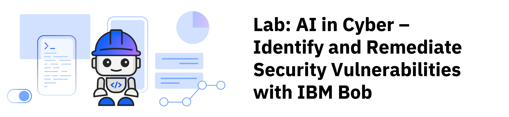

## Overview

Can you spot a security risk before attackers do? Cybersecurity is the practice of protecting systems, networks, applications, and data from digital threats and unauthorized access. Modern software relies heavily on third-party libraries and complex codebases where subtle vulnerabilities can expose organizations to severe operational and data risks. Identifying and remediating these weaknesses early in the software development lifecycle reduces risk, strengthens resilience, and protects critical business assets.

In this lab, you build an AI-assisted DevSecOps and cybersecurity workflow using IBM Bob to inspect an intentionally vulnerable web application, analyze Static Application Security Testing (SAST) and Software Composition Analysis (SCA) scan reports, reproduce authentication vulnerabilities, apply automated code remediations, and rebuild and validate the secure application in an isolated container environment.

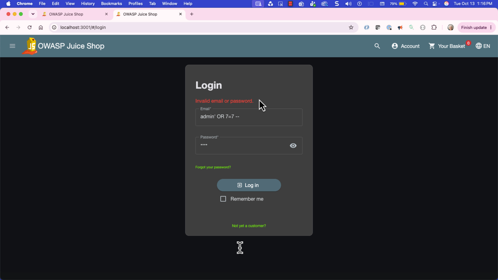

***

## Learning objectives

After completing this lab, you should be able to:

- Understand software security risks, including Static Application Security Testing (SAST) and Software Composition Analysis (SCA).
- Use natural-language prompts in IBM Bob to orchestrate DevSecOps container builds and deployment workflows with Podman.
- Run automated security scans on source code and dependencies to identify high-risk vulnerabilities such as SQL injection.
- Interpret vulnerability scan reports, understand Common Weakness Enumerations (CWEs), and evaluate security impact.
- Reproduce an authentication bypass vulnerability in a controlled, isolated training environment.
- Use IBM Bob to generate, review, and apply secure source-code remediations using parameterized queries.
- Rebuild, redeploy, and perform regression testing on a remediated application to verify vulnerability mitigation.

***

## About this lab

In this lab, you play the role of a DevSecOps engineer evaluating an open-source web application: **OWASP Juice Shop**. The web application runs successfully but contains security vulnerabilities that could allow unauthorized administrative access and data exposure.

Your objective is to collaborate with IBM Bob to discover, triage, remediate, and verify the security posture of the application across the following end-to-end workflow:

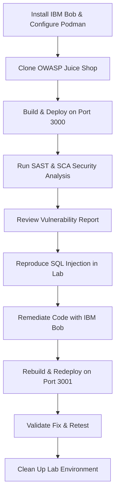

## What is cybersecurity?

This lab focuses on Static Application Security Testing (SAST) and Software Composition Analysis (SCA) vulnerability analysis, remediation, redeployment, and verification. SAST and SCA are two complementary approaches used to identify security vulnerabilities in applications.

SAST analyzes an application's source code, bytecode, or binaries without executing the application. It helps developers find security weaknesses such as SQL injection risks, cross-site scripting (XSS), insecure coding practices, and authentication flaws early in the development process. 

SCA focuses on the third-party and open-source components used within an application. It identifies known vulnerabilities, license compliance issues, and outdated dependencies by comparing software packages against vulnerability databases. 

For example, if an application contains a custom-written authentication module with weak password validation, SAST can help detect the coding issue. If the application uses an outdated version of a logging library with a published CVE, SCA can identify that vulnerable dependency.

Together, SAST and SCA provide broader coverage by helping teams secure both the code they write and the software components they consume. This is why they are commonly included in modern DevSecOps and secure software development workflows.

### Understanding SAST and SCA

This lab focuses on two complementary application security testing disciplines:

- **Static Application Security Testing (SAST):** Analyzes source code, bytecode, or application binaries without executing the software. It identifies coding flaws such as SQL injection, cross-site scripting (XSS), insecure deserialization, and missing authentication checks.
- **Software Composition Analysis (SCA):** Analyzes the third-party and open-source dependencies used by an application. It detects known Common Vulnerabilities and Exposures (CVEs) and outdated packages by checking manifests against national and commercial vulnerability databases.

Together, SAST and SCA provide complete visibility by helping security and development teams secure both the custom code they author and the open-source libraries they include.

***

## About the target application

This lab uses **OWASP Juice Shop**, an open-source web application designed by the Open Web Application Security Project (OWASP) for security training and vulnerability demonstration.

**Tip:** Right-click the following links, and open the pages in a new tab.

- [OWASP Juice Shop GitHub Repository](https://github.com/juice-shop/juice-shop)
- [OWASP Top 10 Security Risks](https://owasp.org/www-project-top-ten/)

> **Safety notice:** All vulnerability testing, exploitation reproduction, and security scanning in this lab must be performed strictly within your local, isolated training container environment. Never scan, probe, or test applications or systems without explicit authorization.

***

## Estimated time

**60 minutes**

***

## Prerequisites

**Tip:** Right-click the following links, and open the pages in a new tab.

Complete the prerequisite tasks of [Get started with IBM Bob](../../ai-in-sports/get-started-with-ibm-bob.md)

### System requirements

This lab performs containerized builds and scans locally. Ensure your system meets the following recommendations:

- **CPU:** 8+ cores (minimum 4 cores allocated to containers)
- **Memory (RAM):** 16+ GB (minimum 6 GB allocated to containers)
- **Storage:** 50+ GB available disk space
- **Permissions:** Administrator/sudo permissions to install and configure software
- **Browser:** Any modern web browser (e.g., Firefox, Chrome, Edge)

***

<a name="top"></a>

## Contents

- [Task 1: Set up the project and container environment](#task01)
- [Task 2: Build and deploy the target application](#task02)
- [Task 3: Scan the source code for vulnerabilities](#task03)
- [Task 4: Analyze the vulnerability scan report](#task04)
- [Task 5: Reproduce the vulnerability in the test environment](#task05)
- [Task 6: Remediate the security vulnerability](#task06)
- [Task 7: Rebuild, redeploy, and retest the application](#task07)
- [Task 8: Validate the remediation](#task08)
- [Task 9: Clean up lab files and containers](#task09)
- [Summary](#summary)
- [Additional resources](#additional-resources)

***

# Preview the tutorial

Watch the following video to see a preview of the steps in this tutorial.

**Note:** Some user interface elements in the video might look different from your IBM Bob environment.

**Tip:** Right-click the following thumbnail image, and open the video in a new tab.

<a href="https://video.ibm.com/embed/channel/23669513/video/ai-in-cyber">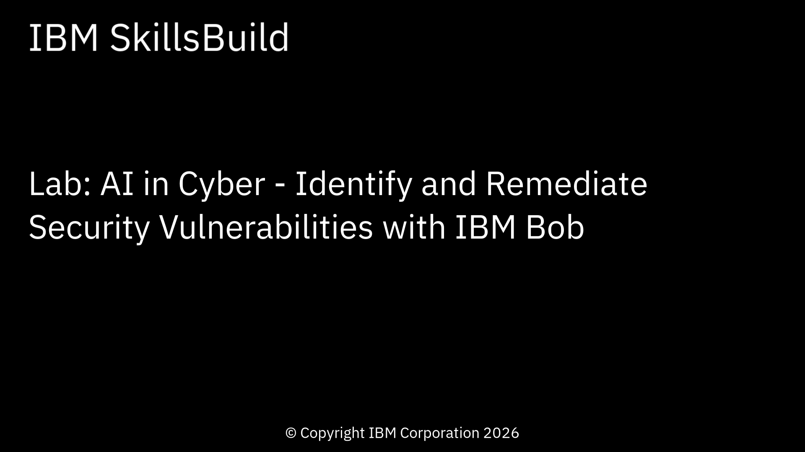</a>

***

<a name="task01"></a>

## Task 1: Set up the project and container environment

In this task, you prepare your development workspace by configuring Red Hat Podman for isolated container execution and cloning the target application repository.

## Task 1a: Configure the Podman container environment

Follow these steps to configure your Podman container engine:

1. In the IBM Bob chat side panel, select **Agent** mode.

   

1. In the Bob chat panel, copy and paste the following prompt:

   ```text
   Please download, install, and run a Podman container environment with 4 CPUs, 6 GB RAM, and 50 GB storage.
   ```
   > **Note:** The suggested values (4 CPUs, 6 GB RAM, 50 GB storage) are reasonable minimums for running OWASP Juice Shop locally. If your system has more resources available you can increase them; the lab prerequisites specify 8+ CPUs and 16+ GB RAM. Resource configuration and the exact Podman Desktop workflow vary by operating system and Podman version — follow the environment-specific instructions provided by your installed tooling.

1. To confirm permission to complete the tasks, click **Approve once** when prompted by Bob, and follow the prompts.

### What Bob does

Bob inspects your host operating system and executes the necessary setup commands:

- Verifies or initializes the Podman container machine with 4 CPUs, 6 GB RAM, and 50 GB storage allocation.
- Confirms the container engine daemon is running and operational.

The following image shows the verified Podman environment:

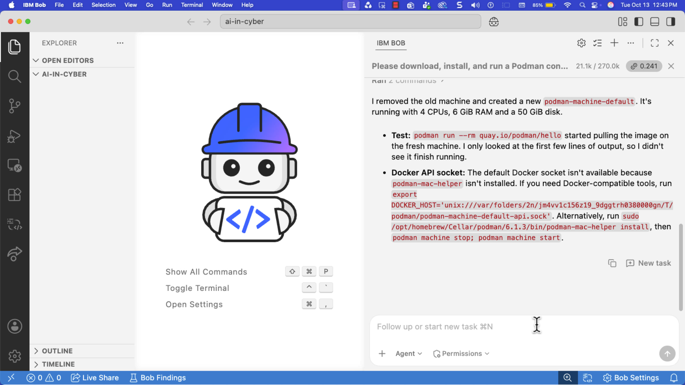

## Task 1b: Clone the source code repository

Follow these steps to clone the OWASP Juice Shop repository:

1. Copy and paste the following prompt into Bob's chat panel:

   ```text
   Please clone OWASP Juice Shop and then open the folder in the Explorer panel.
   ```

1. To confirm permission to complete the tasks, click **Approve once** when prompted by Bob, and follow the prompts.

### What Bob does

Bob completes the following tasks:

- Clones the official OWASP Juice Shop project repository into the workspace.
- Opens and displays the project tree in the Explorer panel.

The following image shows the cloned repository structure:

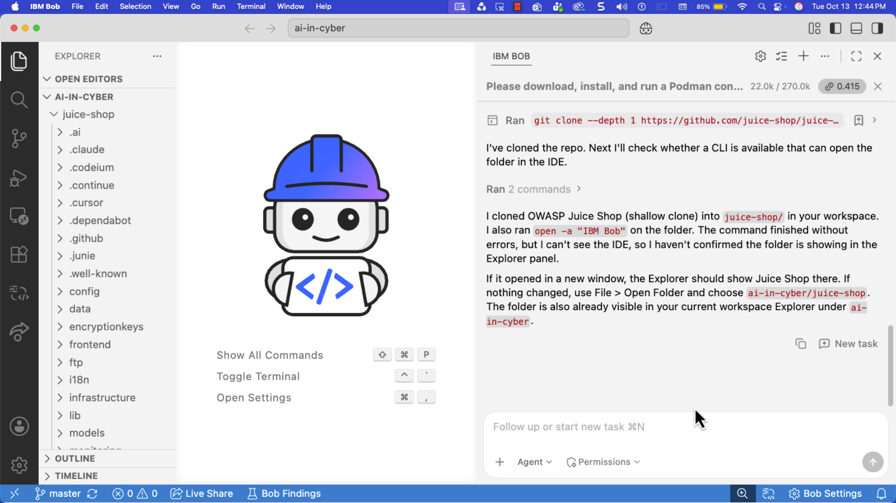

[Back to the top](#top)

***

<a name="task02"></a>

## Task 2: Build and deploy the target application

In this task, you build the initial container image from the cloned source code and run the application on port `3000` to establish a baseline test deployment.

Follow these steps to build and launch the application:

1. Copy and paste the following prompt into Bob's chat panel:

   ```text
   Please use this cloned code to build an image. Do not run the image, but instead give me instructions on how to run the image at TCP port 3000 in Podman myself via the terminal.
   ```

   > **Note:** Building the container image compiles application assets and may take 5–10 minutes depending on your hardware and network speed.

1. To confirm permission to complete the tasks, click **Approve once** when prompted by Bob, and follow the prompts.

## What Bob does

Bob executes the container build workflow:

- Builds a container image tagged for the project using Podman.
- Provides terminal execution commands to launch the container mapped to host port `3000`.

## Explore the application

1. In the terminal window, start the container using the command provided by Bob (similar to):

   ```bash
   podman run -d --name juice-shop -p 127.0.0.1:3000:3000 localhost/juice-shop:local
   ```

1. Open your web browser and navigate to:

   ```text
   http://localhost:3000
   ```

1. Explore the application interface:
   - Dismiss the welcome banner and cookie notification.
   - Observe that the e-commerce store loads products, categories, and user navigation menus.

The following image shows the running application on port `3000`:

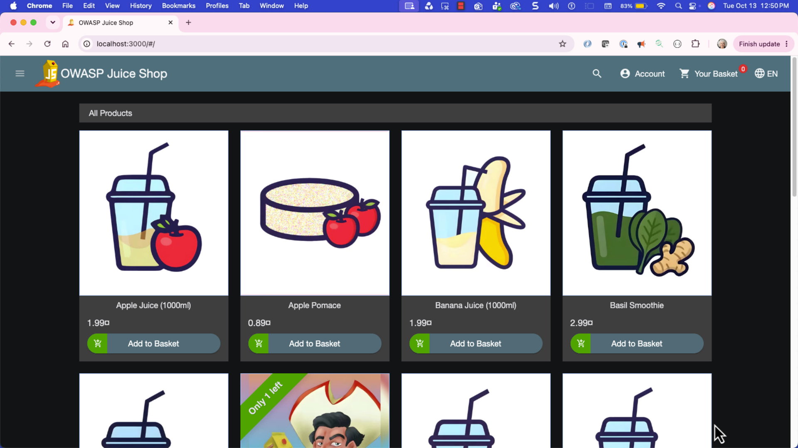

[Back to the top](#top)

***

<a name="task03"></a>

## Task 3: Scan the source code for vulnerabilities

In this task, you prompt Bob to perform Static Application Security Testing (SAST) and Software Composition Analysis (SCA) across the codebase and generate an interactive vulnerability report.

Follow these steps to initiate the security scan:

1. Copy and paste the following prompt into Bob's chat panel:

   ```text
   Please run a cybersecurity analysis on this clone, download the HTML report, and open this HTML report 
   in the middle section of this user interface using the integrated browser.
   ```

   > **Note:** Bob selects an appropriate security scanning tool based on the project ecosystem (such as `npm audit`, `Semgrep`, `Trivy`, or `Grype`). The exact scan duration and formatting may vary based on the analyzer selected.

1. To confirm permission to complete the tasks, click **Approve once** when prompted by Bob, and follow the prompts. Alternatively, you can click **Approve for this task** to grant blanket permissions to read the files.

## What Bob does

Bob executes the security analysis workflow:

- Scans source files and dependency manifests for insecure coding patterns and known CVEs.
- Aggregates findings into severity tiers (Critical, High, Medium, Low).
- Generates an HTML security report and renders it in the integrated panel.

The following image shows the generated security vulnerability report:

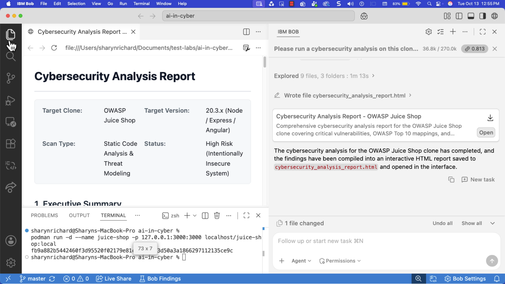

[Back to the top](#top)

***

<a name="task04"></a>

## Task 4: Analyze the vulnerability scan report

In this task, you review the findings in the security report, evaluate the risk, and select the critical SQL injection flaw in the authentication route for investigation and remediation. The objective is to identify security findings in the application source code and dependencies and determine which finding should be investigated first.

Follow these steps to analyze the findings:

1. Review the generated vulnerability report which displays a list of multiple vulnerability findings with severity levels (Critical, High, Medium, Low).

1. Inspect the findings categorized under **Critical** and **High** severity. 

1. Locate the vulnerability finding associated with **SQL Injection (CWE-89)** in the user login and product search endpoints. At least one finding should reference SQL injection in the login or search route.

1. Note the key finding attributes for your remediation plan:
   - **Vulnerability:** SQL Injection / Authentication Bypass (CWE-89)
   - **Affected Component:** User authentication login handler (`routes/login.ts` or `routes/login.js`) and search query routes.
   - **Impact:** An unauthenticated attacker can manipulate SQL queries through user input fields to bypass password authentication, log in as administrator, and exfiltrate user databases.
   - **Recommended Fix:** Replace dynamically concatenated SQL query strings with parameterized queries or prepared statement methods in the underlying ORM/database client.

1. Record at least the following information:

   - Finding name
   - Affected application area
   - Relevant source-code location
   - Security impact
   - Recommended remediation
   - Verification method — how you will confirm the vulnerability is fixed (for example, attempting the SQL injection string against the remediated deployment, or re-running the scan and confirming the finding is absent)

The following image shows the detailed SQL injection finding:

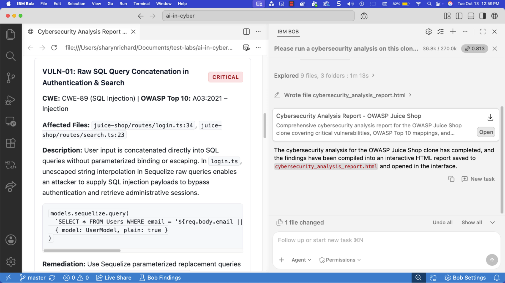

[Back to the top](#top)

***

<a name="task05"></a>

## Task 5: Reproduce the vulnerability in the test environment

In this task, you validate the vulnerability by executing an authentication bypass attack against your local instance running on port `3000`.

> **Safety reminder:** Perform these steps only against your isolated local container (`http://localhost:3000`).

Follow these steps to reproduce the SQL injection vulnerability:

1. In your browser, navigate to your baseline application:

   ```text
   http://localhost:3000
   ```

1. In the upper-right corner, click **Account** and select **Login**.

   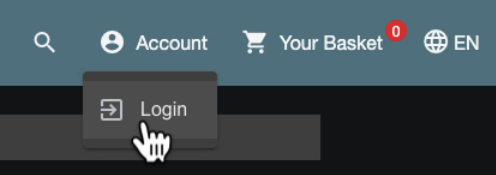

1. In the **Email** field, enter the classic SQL injection bypass payload:

   ```text
   admin' OR 7=7 --
   ```

1. In the **Password** field, enter any arbitrary test string (for example):

   ```text
   1234
   ```

1. Click **Log in**.

1. Observe the result:
   - The application evaluates the SQL condition `7=7` as true and comments out the remainder of the query (`--`), bypassing password verification.
   - You are successfully authenticated into the application as the **admin** user without supplying the administrator password!

The following image shows the successful authentication bypass:


[Back to the top](#top)

***

<a name="task06"></a>

## Task 6: Remediate the security vulnerability

In this task, you prompt IBM Bob to rewrite the vulnerable login and search database queries to use safe, parameterized statements, and review the code diff.

Follow these steps to remediate the vulnerability:

1. Copy and paste the following prompt into Bob's chat panel:

   ```text
   Please remediate SQL injection in login and search.
   ```

1. To confirm permission to complete the tasks, click **Approve once** when prompted by Bob, and follow the prompts.

1. Once Bob completes the remediation, review the proposed changes carefully before accepting them. Confirm that the remediation addresses the underlying source-code issue (for example, switching to parameterized queries or a prepared-statement ORM method) rather than merely suppressing the security finding.

1. Prompt Bob to request a diff of the modified files by copying and pasting the following prompt:

   ```text
   Please display the source-code changes you just made in the middle section of this user interface using the integrated browser.
   ```

1. To confirm permission, click **Approve once** when prompted.

1. Review the diff file showing changes to the login and/or search route files. Look for the removal of raw string interpolation into SQL queries and the addition of parameterized query syntax or an ORM call that separates data from query structure. Bob documents:

   - Files changed
   - Functions or routes changed
   - Security control applied
   - Why the change mitigates SQL injection
   - Any regression-testing considerations

## What Bob does

Bob performs the following remediation steps:

- Locates the login query logic in `routes/login.ts` (or `routes/login.js`) and search query logic in `routes/search.ts`.
- Replaces raw string interpolation (e.g., `"SELECT * FROM Users WHERE email = '" + req.body.email + "'..."`) with parameterized query placeholders (e.g., using Sequelize or SQLite parameterized bindings `models.sequelize.query(..., { replacements: { ... } })`).
- Displays a visual code diff comparing before and after changes.

The following image shows the source-code diff:

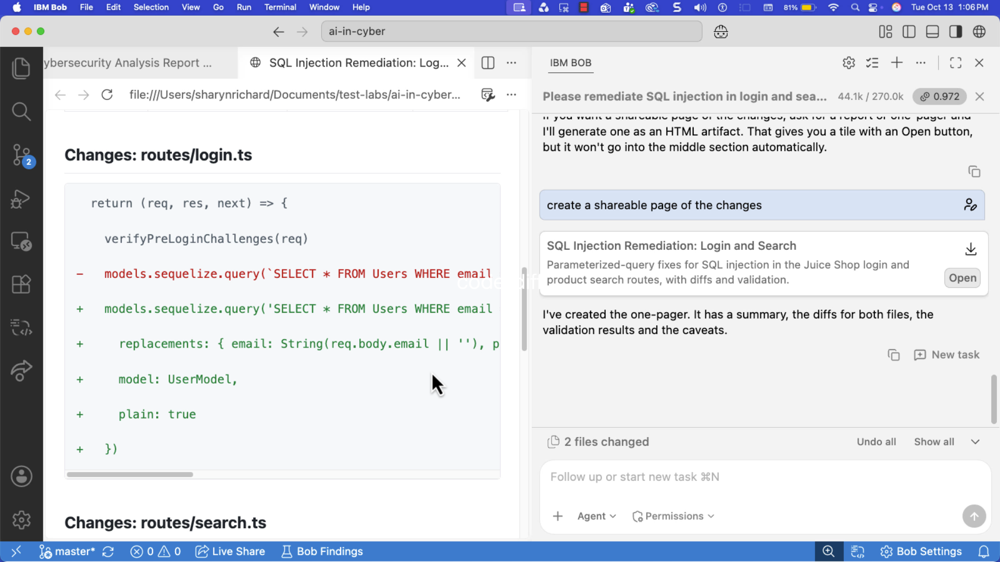

[Back to the top](#top)

***

<a name="task07"></a>

## Task 7: Rebuild, redeploy, and retest the application

In this task, you build a new container image from the remediated source code, deploy it on a separate port (`3001`), and prompt Bob to execute automated retesting.

Follow these steps to rebuild and redeploy:

1. Copy and paste the following prompt into Bob's chat panel:

   ```text
   Please use this changed code to build a new image. Do not run the image, but instead give me 
   instructions on how to run the image at TCP port 3001 in Podman myself via the terminal.
   ```

1. To confirm permission to complete the tasks, click **Approve once** when prompted by Bob, and follow the prompts.

1. In the terminal window, start the container using the command provided by Bob (similar to):

   ```bash
   podman run -d --name juiceshop-sqli-fix -p 3001:3000 localhost/juice-shop:sqli-fix
   ```

1. Open your web browser and navigate to:

   ```text
   http://localhost:3001
   ```

1. Once the container is running on port `3001`, prompt Bob to verify the fix automatically:

   ```text
   Please verify that SQL injection in the login form is no longer reproducible on http://localhost:3001.
   ```

1. To confirm permission, click **Approve once** when prompted.

## What Bob does

Bob performs the following redeployment and validation tasks:

- Compiles and builds a updated container image from the patched source code.
- Runs the remediated container mapped to host port `3001`.
- Issues automated HTTP POST authentication requests containing the SQL injection payload against `http://localhost:3001/rest/user/login`.
- Confirms that the server returns an HTTP 401 Unauthorized / Invalid Credentials status rather than an administrative session token.

The following image shows Bob's automated retest verification:

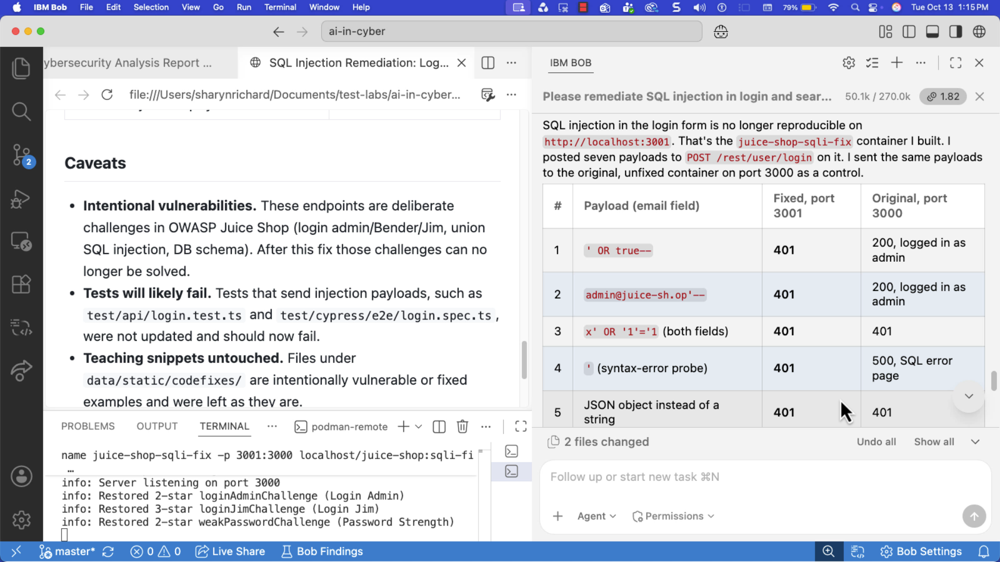

[Back to the top](#top)

***

<a name="task08"></a>

## Task 8: Validate the remediation

In this task, you manually repeat the authentication bypass test against the remediated application on port `3001` to confirm that the vulnerability is resolved and normal authentication works as expected.

Follow these steps to validate the fix in your browser:

1. In your browser, open a new tab and navigate to the remediated application:

   ```text
   http://localhost:3001
   ```

1. Click **Account** > **Login**.

1. In the **Email** field, enter the same test injection payload:

   ```text
   admin' OR 7=7 --
   ```

1. In the **Password** field, enter:

   ```text
   1234
   ```

1. Click **Log in**.

1. Observe the result:
   - The application treats the input as a literal string rather than executable SQL syntax.
   - An **"Invalid email or password"** error message is displayed, and access is denied.

1. Test normal login behavior (if a valid test account exists) or registration to ensure no functional regression was introduced. Bob may have included admin login information in the summary. For example:
   - Email: `admin@juice-sh.op`
   - Password: `admin123`

The following image shows the failed injection attempt on the remediated application:


[Back to the top](#top)

***

<a name="task09"></a>

## Task 9: Clean up lab files and containers

In this task, you prompt Bob to stop running containers, remove test images, and remove temporary workspace directories to return your environment to a clean state.

Follow these steps to clean up:

1. Copy and paste the following prompt into Bob's chat panel:

   ```text
   Please stop the cloned application image and remove the cloned images from Podman.
   ```

1. To confirm permission, click **Approve once** when prompted.

1. Copy and paste the following prompt into Bob's chat panel:

   ```text
   Please remove the cloned OWASP Juice Shop source directory.
   ```

1. To confirm permission, click **Approve once** when prompted.

## What Bob does

Bob executes cleanup operations:

- Stops and removes running containers on ports `3000` and `3001`.
- Prunes temporary container build images from Podman storage.
- Deletes the cloned repository directory from the local file system.

The following image shows the completed cleanup confirmation:

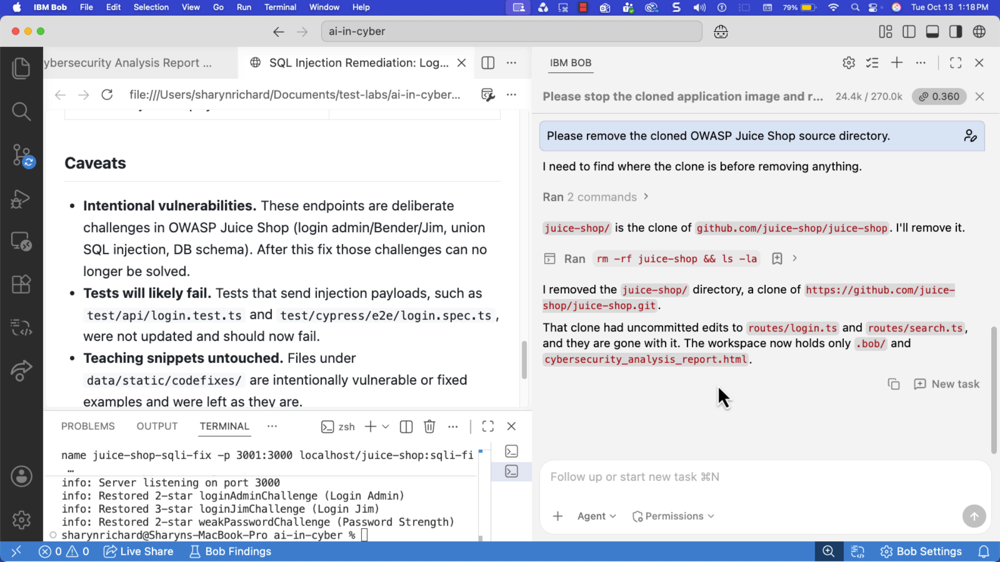

[Back to the top](#top)

***

<a name="summary"></a>

## Summary

In this lab, you used IBM Bob to execute a comprehensive cybersecurity vulnerability assessment and remediation workflow. You deployed a containerized web application using Podman, ran automated SAST and SCA scans, reproduced an authentication bypass flaw using SQL injection, applied secure code remediations with parameterized queries, and rebuilt and validated the secure application.

### What you learned

Now that you have completed this lab, you should be able to:

- Understand software security risks, including Static Application Security Testing (SAST) and Software Composition Analysis (SCA).
- Use natural-language prompts in IBM Bob to orchestrate DevSecOps container builds and deployment workflows with Podman.
- Run automated security scans on source code and dependencies to identify high-risk vulnerabilities such as SQL injection.
- Interpret vulnerability scan reports, understand Common Weakness Enumerations (CWEs), and evaluate security impact.
- Reproduce an authentication bypass vulnerability in a controlled, isolated training environment.
- Use IBM Bob to generate, review, and apply secure source-code remediations using parameterized queries.
- Rebuild, redeploy, and perform regression testing on a remediated application to verify vulnerability mitigation.

[Back to the top](#top)

<a name="additional-resources"></a>

## Additional resources

- [IBM Bob documentation](https://bob.ibm.com/docs)
- [OWASP Top 10 Security Risks](https://owasp.org/www-project-top-ten/)
- [OWASP SQL Injection Prevention Cheat Sheet](https://cheatsheetseries.owasp.org/cheatsheets/SQL_Injection_Prevention_Cheat_Sheet.html)
- [Podman Documentation](https://podman.io/docs)
- [Common Weakness Enumeration - CWE-89 (SQL Injection)](https://cwe.mitre.org/data/definitions/89.html)
